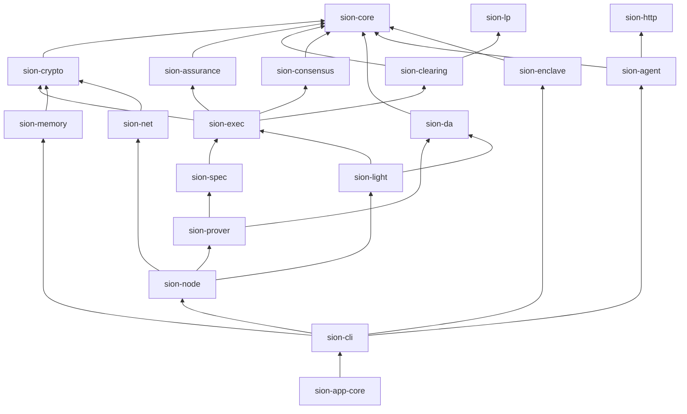
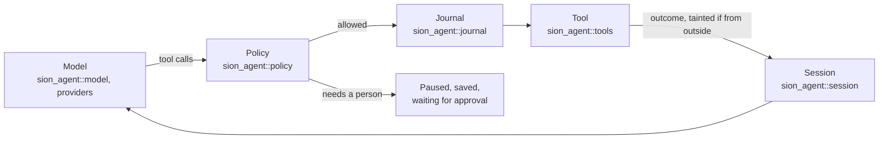

# Architecture

A tour of the code for someone about to read or change it: how the
workspace is laid out, what each layer decides, how a transaction and a
Pulse go through it, how the agent runtime is built, which rules hold
everywhere, and where to start reading. The book's
[Architecture of the code](docs/book/src/architecture/crates.md) chapters go
deeper into each part; the [specification](docs/spec/state-transition.md)
is the authority on the rules of the state transition; and
[`docs/implementation-status.md`](docs/implementation-status.md) is the
authority on what is built, simplified, simulated or missing.

## Two halves

The repository holds two things that meet at one boundary:

- **The ledger**, from `sion-core` up to `sion-node`: state, ordering,
  execution, data availability, proofs and light clients, run as a devnet.
- **The agent**, `sion-agent` and the parts of `sion-cli` that run it: a
  language model at work as an agent identity, with tools, under a policy
  the runtime enforces on the operator's machine.

They meet at the agent's **charter**. The runtime decides what the agent
tries; the validators decide what it may do with money, checking every
payment against the charter whatever the runtime allowed. A runtime that is
misconfigured or fooled still cannot spend beyond it
(`sion_agent::policy` says so at its top).

## The crates

Nineteen crates in one Cargo workspace. Each depends only on crates below
it, and on `sion-core` rather than on its neighbours where it can. An arrow
points from a crate to what it depends on (with the dependencies that
follow from others left out):

| Layer | Crates | What it decides |
|---|---|---|
| Foundations | [`sion-core`](crates/sion-core), [`sion-crypto`](crates/sion-crypto), [`sion-lp`](crates/sion-lp), [`sion-http`](crates/sion-http) | How values are encoded and hashed, identifiers and money, logs and state trees; signatures and encryption; exact linear programming; outbound HTTPS |
| Mechanisms | [`sion-assurance`](crates/sion-assurance), [`sion-clearing`](crates/sion-clearing), [`sion-da`](crates/sion-da), [`sion-consensus`](crates/sion-consensus), [`sion-memory`](crates/sion-memory) | What a claim's evidence is worth; how a market clears; how data is coded and sampled; how owned objects are certified and contended ones ordered; how memory logs and their proofs work |
| The state transition | [`sion-exec`](crates/sion-exec) (stack A), [`sion-spec`](crates/sion-spec) (stack B), [`sion-prover`](crates/sion-prover) | What a transaction and a Pulse do to the state, written twice, independently; World Proofs over both |
| Verification | [`sion-light`](crates/sion-light) | What a client with only the genesis chain identity can check |
| The node | [`sion-node`](crates/sion-node), [`sion-net`](crates/sion-net) | Validators, the gateway, the prover thread, durability, the HTTP API; QUIC between processes |
| The agent runtime | [`sion-agent`](crates/sion-agent), [`sion-enclave`](crates/sion-enclave) | The run loop, models, tools and their effects, the policy, the journal, the sandbox, the browser, MCP, skills; the attestation of an enclave an agent is rented out from |
| The command | [`sion-cli`](crates/sion-cli), [`sion-app-core`](crates/sion-app-core) | Everything a person runs: the devnet, wallets, the ledger's commands, the agent's profiles, channels and services, renting, ACP and AP2; the app's core |

`sion-spec` uses `sion-exec`'s types only, never its logic: that is what
makes it a second implementation
([Keeping proof stack B independent](docs/book/src/architecture/independence.md)).
The app's window, `apps/sion-app/src-tauri`, is a Cargo workspace of its
own on top of `sion-app-core`, so that its GUI dependencies stay out of the
protocol's.

## State

The state is two-sorted
([Two-sorted state](docs/book/src/concepts/two-sorted-state.md)):

- **Objects** are linear resources (coins, allotments, positions,
  accounts, charters). Each has an identifier and a version, and is consumed
  at most once; a consumed object is tombstoned, never deleted.
- **Claims** are knowledge. They are appended to a grow-only log (the RFC
  9162 log of `sion_core`) and never conflict with one another.

`sion_exec::State` holds both, and its roots go in every Pulse header: the
sparse Merkle tree over objects, the knowledge log's root, and the
validator set. A transaction's coordination class follows from what it
touches: owned objects only, shared objects through escrowed allotments, or
contended objects that need ordering.

## A transaction

One transfer, `sion send dana alice 12.5`, step by step
([the full chapter](docs/book/src/architecture/transaction-flow.md)):

1. **The wallet** (`sion_cli::session`, `sion_exec::wallet`) selects coins,
   sets the fee and expiry, and signs the digest with ML-DSA-44 and
   SLH-DSA-SHA2-128f under a context bound to the chain.
2. **The API and the gateway** (`sion_node::api`, `sion_node::gateway`)
   take it, derive the sender's shard, and route it: every transaction goes
   to the shard's lane committee first.
3. **The lane committee** (`sion_consensus::lanes::LaneValidator`, driven
   by `sion_node::validator`) checks it, locks each input version to its
   digest, logs the approval, and signs approvals in batches every 25 ms.
4. **The gateway** collects a quorum of approvals into a lane certificate:
   for owned objects, the transaction is now final. It hands certificates
   to consensus in groups.
5. **Consensus** (`sion_consensus::core`) orders them in a certified DAG,
   and the Pulse builder (`sion_node::pulses`) cuts the commit sequence
   into Pulses.
6. **Every validator executes the Pulse** (`sion_exec::pulse::execute_pulse`),
   publishes its data with 2D Reed–Solomon coding (`sion-da`), appends it
   to the write-ahead log, and signs the header, which is certified once
   more than two thirds of the stake has signed.
7. **The prover** (`sion_node::prover`) builds a World Proof with stacks A
   and B, and verifies it.
8. **The client** fetches the receipt with its Merkle path, and
   `sion receipt` checks it against the certified header as a light client
   does (`sion_light`).

## A Pulse

A Pulse is the unit of execution, about a second of committed transactions.
`sion_exec::pulse` runs it in three phases: owned transactions in digest
order (they commute: each owned input is locked to one transaction by its
lane certificate, and none writes a shared object that already exists),
contended ones in commit order, then a deferred phase that applies the
commutative effects of both (claims, bonds, orders, fees), posts the forced
intents, and runs what the schedule says is due (batch sealing, clearing
deadlines, forced-inclusion deadlines, the end of an epoch). Claims may cite
only claims of earlier Pulses, so the knowledge phase never depends on the
order of transactions within a Pulse. Execution cuts the Pulse into chunks, each with
the state commitment before and after and a witness, which a proof stack can
replay statelessly and in parallel (`sion_exec::stateless::replay_chunk`).

The World Proof binds the state transition, every receipt, the published
data and every lane certificate. In this implementation it is a **replay
proof**: a verifier re-executes the Pulse, in two independent stacks, so
"proof finality" costs a verifier as much as executing. That stands in for
succinct proofs, and is named as the trust atom `impl:replay-proofs`
([The prover](docs/book/src/architecture/prover.md),
[Succinct validity proofs](docs/book/src/research/succinct-proofs.md)).

Who certifies is part of the state. Committees are derived from the
validator set in the state after every Pulse (`sion_exec::validators`,
`sion_node::committees`), and change only at epoch boundaries, by rules the
World Proof covers.

## The agent runtime

`sion_agent::session` is the loop: it asks the model, runs the tools the
model asks for under the policy, and stops when the work is done, the turns
run out, or a person must decide.

- **Tools** declare their effect: a read, a write, an external call or a
  spend (`sion_agent::tools`). The autonomy level (L0 to L6) decides what
  runs, what waits for a person and what is refused (`sion_agent::policy`).
- **Taint**: what comes from outside (a page, a search result, an email)
  marks the session, and a tainted session asks before every external call;
  in quarantine, outside content reaches the model only through a reader
  with no tools (`sion_agent::quarantine`).
- **The journal** records every call that changed something, so that
  nothing is done twice by accident, and a call whose outcome is unknown is
  not repeated until someone settles it (`sion_agent::journal`).
- **Sessions** are saved, pause for approval, and resume, in the same
  process or another (`sion_cli::runtime`).
- **Containment**: commands run in bubblewrap or Docker with the workspace
  as the only place they can write and no network unless the operator gives
  one (`sion_agent::sandbox`); a skill's scripts reach only the hosts it
  declares, through a filtering proxy (`sion_agent::egress`).

`sion-cli` turns a profile into a running agent: `sion_cli::runtime`
mounts the tools a profile has (the ledger's, the workspace's, the shell,
the browser, MCP servers, subagents), `sion_cli::channels` keeps each
conversation's session, `sion_cli::bridge` answers the messengers,
`sion_cli::work` runs the work the agent takes on, and `sion_cli::talk` and
`sion_cli::listening` are the terminal and its voice. Selling and buying
are `sion_cli::acp` (ACP's merchant and buyer, cards, 3-D Secure, feeds,
webhooks and request signatures) and `sion_cli::ap2` (mandates);
renting is `sion_cli::rentals`, over `sion_enclave` for attestation, and
`sion_cli::trust` serves the reads other frameworks check an agent by.
`sion_cli::self_improve`, `projects`, `vouching`, `meeting_voice` and
`reputation::rank` are in the library and unit-tested, and no command
reaches them yet. The book's
[Your agent](docs/book/src/agent/index.md) pages describe each part from
the outside.

## Rules that hold everywhere

From [`AGENTS.md`](AGENTS.md), with where each is held:

| Rule | Where |
|---|---|
| Every consensus-critical value has one canonical encoding (Borsh) and is hashed with a domain tag | `sion_core::hash`, `sion_core::encoding` |
| Consensus-critical maps are ordered (`BTreeMap`, `BTreeSet`): no hash order decides anything | Throughout `sion-exec`, `sion-spec`, `sion-consensus` |
| No floating point in consensus logic: money is `Amount`, micro-units in a `u128`; exact optimisation uses rationals | `sion_core` (`Amount`), `sion-lp` |
| Nothing is deleted from state: consumed objects are tombstoned, claims appended | `sion_exec::state` |
| Every trust assumption is named, this implementation's shortcuts included | The trust atoms of [`docs/implementation-status.md`](docs/implementation-status.md) |
| Simulation shortcuts are labelled in the types and in the output | Replay proofs in `sion-prover`; devnet keys (`impl:devnet-keys`) |
| No unsafe Rust | `unsafe_code = "forbid"` in the workspace's lints (`Cargo.toml`) |

Beyond those: newtype identifiers (`sion_core::ids`), errors with
`thiserror`, a doc comment and a test for every public function, and seeded
randomness in every test (`sion_core::rng`).

## Tests

| Kind | Where |
|---|---|
| Unit and property tests (`proptest`) for the algebra, the certificates and the state machine | Each crate's `src/`, and `crates/sion-assurance`, `sion-lp`, `sion-exec` especially |
| A deterministic consensus simulator with adversarial network phases | `sion_consensus` (its simulator) and `crates/sion-consensus/tests` |
| A scenario for every transaction kind, and differential tests between the two stacks | `crates/sion-exec/tests`, `crates/sion-spec/tests` |
| End-to-end devnet tests with dual post-quantum signatures | `crates/sion-node/tests`, `crates/sion-cli/tests` |
| The agent against a scripted model (`sion_agent::scripted`) and stand-ins for the services it talks to, the browser with Chromium in bubblewrap | `crates/sion-agent/tests`, `crates/sion-cli/tests` |
| ACP and AP2 against their published schemas and example tokens, with property tests of the signing and the amounts | `crates/sion-cli/tests/{commerce,commerce_cards,commerce_properties,ap2_vectors,interop}.rs`, [`scripts/interop`](scripts/interop/README.md) |
| The demos, which take minutes (`#[ignore]`, run nightly) | `crates/sion-cli/tests/demos.rs` |

CI ([`.github/workflows`](.github/workflows)) runs `cargo fmt`, `cargo
clippy -D warnings` and the fast suite on every push and pull request,
checks that the site's generated pages match their sources and builds the
book; `nightly.yml` runs the slow tests and the benchmarks; `release.yml`
builds signed release archives on tags.

## Where to start reading

| To understand | Read |
|---|---|
| How a transaction executes | `sion_exec::execute` (one transaction), `sion_exec::pulse` (a Pulse and its phases) |
| The rules both stacks implement | [`docs/spec/state-transition.md`](docs/spec/state-transition.md) |
| What a validator does | `sion_node::validator` ([The validator thread](docs/book/src/architecture/validator.md)) |
| How committees are derived | `sion_exec::validators`, `sion_node::committees` |
| How a light client decides | `sion_light`, `sion_cli::verify` ([Light-client verification](docs/book/src/guides/light-client.md)) |
| What a claim's evidence is worth | `sion_assurance` ([The Assurance Algebra](docs/book/src/concepts/assurance/index.md)) |
| How an agent's run goes | `sion_agent::session`, `sion_agent::policy`, `sion_cli::runtime` |
| How a message on a messenger becomes a run | `sion_cli::bridge`, `sion_cli::channels` ([Channels](docs/book/src/agent/channels.md)) |
| What the CLI prints, as sentences | `sion_cli::describe` |

## Writing about it

Documentation keeps to what is built. Status words are those of
[`docs/implementation-status.md`](docs/implementation-status.md): **Built**
(as the architecture describes, at devnet scale, with tests),
**Simplified** (with a named simplification that changes a guarantee or a
cost), **Simulated** (a labelled stand-in), **Not built**. A number says
where it comes from; command output in the book is from real runs, and the
agent's from runs with a scripted model and stand-ins, as each page says.
