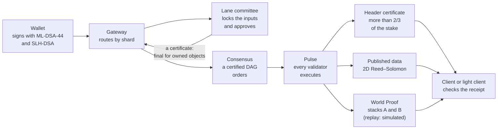
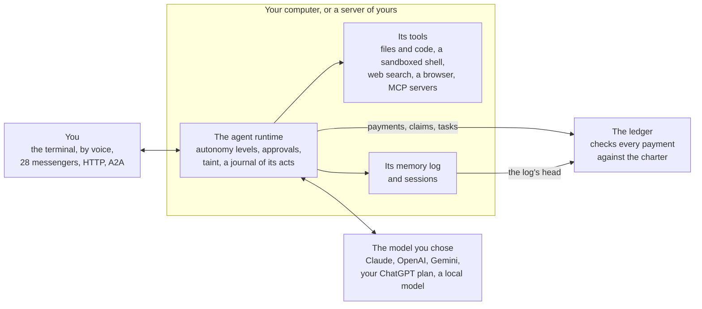

<p align="center">
  <picture>
    <source media="(prefers-color-scheme: dark)" srcset="brand/logo/siontology-lockup-on-dark.svg">
    
  </picture>
</p>

<p align="center">
  A ledger whose product is verified knowledge, and an AI agent that acts
  within limits the ledger enforces.
</p>

<p align="center">
  <a href="https://github.com/shayansal/Siontology/actions/workflows/ci.yml"></a>
  
  
  
</p>

Siontology is an open-source reference implementation, in Rust, of a
**neo-blockchain**: a network whose product is verified knowledge, not
ordered transactions. Every claim it records, about a payment, a
computation, an AI output or a physical event, carries a proof or priced
evidence, and anyone can check it from a phone. It implements the design in
the paper
[*Neo-Blockchains: The Fold Architecture*](docs/book/src/papers/architecture.md).

It comes with **an AI agent you run on your own computer**. `sion setup`
makes a chain of your own and an agent on it, and `sion` talks with it. The
agent answers in the terminal, typed or spoken, on 28 messaging services and
over HTTP. It works in a folder you give it, searches the web, browses,
changes and tests code, remembers, and takes work on by itself from the
GitHub repositories and chats it watches. The ledger holds its spending to
its charter: a payment the charter forbids is refused, whatever the agent
was told.

> **Status.** A devnet-scale reference implementation. Its validity proofs
> are *replay proofs* that stand in for succinct ones, its validators run in
> one process (or as separate processes on one machine, over QUIC), and it
> secures nothing of value. The agent is tested with a scripted model and
> stand-ins for the services it talks to, and no release is published yet.
> [`docs/implementation-status.md`](docs/implementation-status.md) says what
> is built, simplified, simulated or missing; every document here keeps to
> it. Siontology has no token and nothing is on offer. Fees are paid in
> stablecoins.

**Contents:** [Why](#why) · [Get started](#get-started) ·
[How the ledger works](#how-the-ledger-works) · [The agent](#the-agent) ·
[What exists today](#what-exists-today) · [Demos](#demos) ·
[The repository](#the-repository) · [Documentation](#documentation) ·
[Development](#development) ·
[Security, contributing and licence](#security-contributing-and-licence)

## Why

AI made producing text, code and decisions nearly free. Checking them did
not get cheaper. Every AI output, agent action and data feed raises the same
questions: is this real, and who pays if it is not? Agents acting for people
are about to multiply the exchanges between strangers that pay that cost.

Blockchains make one thing trustworthy, their own ledger state. They cannot
check the facts most transactions depend on, every node re-executes every
transaction, and everything is public by default. A neo-blockchain extends
verifiable trust to anything that can carry evidence, and puts a price on
evidence that is not a proof: every claim says what it would cost to falsify
it, and whoever relies on it decides, under their own policy, whether that
is enough for what is at stake.

For AI agents, that means limits that hold even when the agent is fooled:

- a **charter** the validators check on every payment (whom it may pay, its
  largest payment, how fast it may spend, until when);
- **memory** whose past cannot be rewritten, its log's head kept by the
  ledger;
- **work** paid only for a result that passes a rule fixed when the work was
  posted;
- **skills from others** installed only when bonds and audits cover what
  they could cost.

## Get started

### Run an agent of your own

```bash
git clone https://github.com/shayansal/Siontology && cd Siontology
sh scripts/install.sh   # builds sion from this checkout, into ~/.local/bin
sion setup              # a chain of your own, your wallet and your agent's, a model, a profile
sion                    # talk with it; sion -c continues the last conversation
```

Building needs Rust 1.80 or later and a C compiler; `sion doctor` says what
else the machine has. [Run it on your
computer](docs/book/src/getting-started/your-computer.md) walks through
setup, and [Your agent](docs/book/src/agent/index.md) says what the agent
can do.

### Try the ledger

```bash
cargo build --release
alias sion=./target/release/sion
sion demo all --local                # every scripted demo, against an in-process devnet
```

Or run a devnet and use it from another terminal:

```bash
sion devnet                          # 4 validators, 2 shards, the API on 127.0.0.1:8730
sion keys new dana                   # a wallet in ~/.sion/wallets (or $SION_HOME/wallets)
sion faucet dana 100
sion send dana alice 12.5            # prints the sentence it signs, then the outcome
sion verify --chain <the identity sion devnet printed>
```

More to try, each with its page in the book:

| To | Run | Read |
|---|---|---|
| Connect an AI agent over the Model Context Protocol | `sion mcp` | [MCP](docs/book/src/getting-started/mcp.md) |
| Sell an API per request, and pay for it | `sion x402 serve carol --price 0.25`, then `sion x402 fetch …` | [x402](docs/book/src/guides/x402.md) |
| Pay per request from a stream, one hash a request | `sion stream open dana carol --unit 0.001 --deposit 5` | [Streams](docs/book/src/guides/streams.md) |
| Check the chain as a light client | `sion verify --chain <identity>` | [Light client](docs/book/src/getting-started/light-client.md) |
| Measure everything on your machine | `sion bench` | [Benchmarks](docs/book/src/guides/benchmarks.md) |

## How the ledger works

Blockchains chain blocks; DAGs link transactions; neo-blockchains **fold
claims**. Four pieces carry the design:

| Piece | In one sentence | Read |
|---|---|---|
| Two-sorted state | Knowledge never needs coordination; only the consumption of resources is ordered, and only among contenders. | [Two-sorted state](docs/book/src/concepts/two-sorted-state.md) |
| The Assurance Algebra | Every claim carries a formula of its assumptions; anyone computes what an attacker must forfeit to falsify it, relies on it only when that exceeds what is at stake, and reserves that backing. | [The Assurance Algebra](docs/book/src/concepts/assurance/index.md) |
| Verifiable Clearing | A market clearing is valid only with a certificate that no better allocation exists, checked in linear time. | [Verifiable Clearing](docs/book/src/concepts/verifiable-clearing.md) |
| The Fold | Every proof folds into one World Proof per Pulse, so a phone can verify the whole history. | [The Fold](docs/book/src/concepts/the-fold.md) |

A transfer, `sion send dana alice 12.5`, goes through the code like this
(each step's module is named in
[A transaction, from wallet to receipt](docs/book/src/architecture/transaction-flow.md)):



Around the four pieces:

- **Ordering only where it is needed.** An owned object is final once its
  shard's committee certifies the spend, with no consensus round
  ([Linear Lanes](docs/book/src/concepts/linear-lanes.md)). Shared totals
  split into single-writer allotments
  ([Escrow Lanes](docs/book/src/concepts/escrow-lanes.md)). Only contended
  objects go through consensus
  ([Contention Consensus](docs/book/src/concepts/contention-consensus.md)).
- **Agents within limits.** An [Agent Charter](docs/book/src/concepts/agent-charters.md)
  fixes an agent's payees, its largest payment, a spending rate carved down
  its tree of subagents, an expiry and the evidence a payment needs; a
  charter only narrows when delegated, and suspending one stops the whole
  tree. Subagents can be keyless, their nearest keyed ancestor signing up to
  256 of their transactions at once
  ([Batched authorization](docs/book/src/concepts/batched-authorization.md)).
- **Post-quantum from the start.** Every authorization carries signatures
  from two unrelated families, ML-DSA-44 and SLH-DSA-SHA2-128f, so a forger
  must break both; payloads are sealed with ML-KEM-768
  ([Post-quantum identity](docs/book/src/concepts/post-quantum.md)).
- **Data you can check is there.** Each Pulse's data is published with 2D
  Reed–Solomon coding; a light client samples it at random, and a bad
  encoding has a fraud proof
  ([Data availability](docs/book/src/concepts/data-availability.md)).
- **Censorship you can see.** A user the gateway ignores posts straight to
  consensus; the shard then owes the transaction, and every certified header
  counts what a shard owes, so a censoring committee is visible to every
  light client, and replaced
  ([Censorship resistance](docs/book/src/concepts/censorship-resistance.md)).
- **Who certifies is part of the state.** Validators stake, earn fees by
  stake and are slashed for signing two headers for one round; committees
  change only at epoch boundaries, by rules the World Proof covers
  ([Validators, staking and epochs](docs/book/src/concepts/committees.md)).
- **Payments, memory, work and storage.** Payment streams pay by revealing
  a hash chain, one hash a payment
  ([Payment streams](docs/book/src/concepts/payment-streams.md)); memory
  logs for agents and robots keep their heads on the ledger
  ([Memory](docs/book/src/concepts/memory.md)); Task Charters escrow work
  whose acceptance is fixed when it is posted
  ([Task Charters](docs/book/src/concepts/task-charters.md)); storage deals
  pay devices to keep data, proven every round
  ([Storage deals](docs/book/src/concepts/storage.md)).

## The agent



What is enforced, and where:

| What | Where it is enforced |
|---|---|
| What the agent tries: its autonomy level, approvals, taint, quarantine, confidential files | The runtime, on your machine (trust atom `agent:local-policy`) |
| What it can do with money: its budget, its largest payment, whom it may pay, how fast it spends | The ledger: validators check every payment against its charter, whatever the runtime allowed |
| What it remembers | Its memory log on your machine, whose head the ledger keeps and lets only grow |
| Where its conversation goes | The model provider you chose, which sees it (trust atom `agent:provider-sees-context`) |

What it does:

| | | Read |
|---|---|---|
| Talk with it | In the terminal, typed, by push-to-talk, or live (it speaks as it writes, takes its own voice out of what the microphone hears, stops when you talk over it, can wait for a wake word, tells when you have finished by what you said, or talk through a realtime speech model that asks the agent), hearing and speaking through services or on your machine (whisper.cpp, Piper); on 28 messaging services, with voice notes; X's mentions, answered with their sources; over HTTP, OpenAI's chat API and A2A; and it takes meetings' notes, by phone, on your machine or as a guest by the meeting's link, with who said what | [Channels](docs/book/src/agent/channels.md), [Voice](docs/book/src/agent/voice.md), [Messengers](docs/book/src/agent/messengers.md) |
| Its tools | Files and code (edit, patch, search, check, test), a shell in a sandbox, web search, a browser with tabs, downloads and uploads (signed in as you if you give it your profile, handing you the page for a captcha or a code), a desktop of its own, programs that call its tools, your hooks around its calls, MCP servers with their resources, prompts and questions to you, and sion's own servers for mail, calendars and documents | [Tools](docs/book/src/agent/tools.md), [Browser](docs/book/src/agent/browser.md) |
| What it does alone | Autonomy levels from L0 to L6, approvals, taint from what comes from outside, quarantine, confidential files | [Autonomy](docs/book/src/agent/autonomy.md) |
| Memory | A memory log whose head the ledger keeps, search over past sessions, consolidation and dreaming | [Memory](docs/book/src/agent/memory.md) |
| Skills | Its own; taught by doing a task once in a browser; others', installed on bonds and audits or imported from a folder, a repository, ClawHub or skills.sh after an audit of their files; skills that get better through evaluation that others verify | [Skills](docs/book/src/agent/skills.md), [Improvement](docs/book/src/agent/skill-improvement.md) |
| Helpers | Subagents with budgets carved from its own, in git worktrees of their own when they change code, other agents hired through Task Charters, graphs of agents |
| Renting it out | List it by the token in an enclave renters can check (AMD SEV-SNP, attested), paid through a payment stream for the tokens the enclave signed for, its sessions holding none of your memory, files or reach; and every agent's record read from the ledger, to find the best one for a task | [Renting](docs/book/src/agent/renting.md), [Records](docs/book/src/agent/teams.md) | [Teams](docs/book/src/agent/teams.md), [Graphs](docs/book/src/agent/graphs.md) |
| Work it takes on | It watches GitHub repositories and chats, a fixed gate decides what it may take on, every piece of work has a mandate on the ledger, and it follows its pull requests' reviews and failed checks | [Work](docs/book/src/agent/work.md) |
| Models | Claude, OpenAI, Gemini, your ChatGPT plan or a local model, their reasoning kept across tool calls and how hard they think set per model, and a model for each kind of task, chosen by rule or by a small model and compared on your own tasks | [Models](docs/book/src/agent/models.md) |
| Coming from OpenClaw or Hermes | Its persona, memories, jobs, models, keys and chats brought over to a profile, a plan shown first | [Import](docs/book/src/agent/import.md) |
| Where it runs | Your computer, or a server of yours: `sion deploy` puts it there, `sion agent up` keeps it running | [Run it on a server](docs/book/src/agent/server.md) |

## What exists today

[`docs/implementation-status.md`](docs/implementation-status.md) is the
authority, with every simplification and the trust assumptions the
implementation adds. In short:

- **Built**, at devnet scale and with tests: two-sorted state; post-quantum
  accounts; Agent Charters, agent identities, subagents and batched
  authorization; Linear and Escrow Lanes; committees, epochs, staking and
  slashing; two levels of finality; two independent proof stacks; claims
  and the Assurance Algebra; Verifiable Clearing; encrypted payloads,
  viewing keys and sealed orders; data availability coding, sampling,
  reconstruction and fraud proofs; payment streams, memory logs, Task
  Charters and storage deals; the CLI, the HTTP API and the MCP server.
- **Simplified**: consensus is a certified DAG, not an uncertified one;
  forced inclusion replaces a censoring committee but does not freeze the
  shard; data retention and archival; networking between machines (QUIC
  between processes, peers from files, tested on one machine).
- **Simulated**: validity proofs. A World Proof is checked by replaying the
  Pulse in two independent stacks, a stand-in for succinct proofs, with
  real bindings to the state, receipts, data and certificates
  (`impl:replay-proofs`).
- **Partly built**: the agent runtime (tested with a scripted model and
  stand-ins); interfaces to other standards (x402 is built; AP2, ERC-8004
  and C2PA are not); the app (the desktop shell is built and run; mobile is
  configured, not built).
- **Not built**: personhood claims, a proving market, confidential amounts
  and zero-knowledge compliance, payments to provers and the value-in-flight
  cap.

<details>
<summary>The status of every section of the architecture</summary>

| Architecture section | Status |
|---|---|
| Foundations: two-sorted state, derived coordination class | Built |
| Identity: post-quantum accounts | Built |
| Identity: personhood | Not built |
| Identity: Agent Charters | Built |
| Identity: agent identities and subagents | Built (devnet scale) |
| Identity: batched authorization and keyless subagents (beyond the paper) | Built (devnet scale) |
| Agents: a runtime that lets a model work as an agent identity, within its charter (beyond the paper) | Partly built (runtime with providers and a scripted model, memory, the agent's own skills, skills from others installed through bonds and audits, self-improvement with verified promotion, subagents, hiring, schedules and channels, a sandboxed shell, skills' scripts with the permissions their skills declare, MCP servers over standard input and output or HTTP with OAuth, a browser and a desktop with tabs, downloads and files to upload, storage deals, work it takes on by itself from GitHub and chats under mandates, its pull requests' reviews and checks followed, web search, tools to change code and check it, MCP resources, prompts, input and sampling, sion's own mail, calendar and documents servers, skills imported from folders and repositories, everything kept running on a server, live voice with a wake word, reasoning kept across tool calls, tool search, programs that call tools, the operator's hooks, subagents in git worktrees, voice on the machine, a meeting guest that tells speakers apart, a browser signed in as you that hands you its page, renting an agent out by the token in an attested enclave, agents' records from the ledger) |
| Data availability: 2D Reed–Solomon, sampling, reconstruction, fraud proofs | Built |
| Data availability: retention and archival | Simplified |
| Ordering: Linear Lanes (owned objects) | Built |
| Ordering: Escrow Lanes (bounded shared totals) | Built |
| Ordering: Contention Consensus | Simplified (certified DAG, not uncertified) |
| Ordering: censorship resistance (forced inclusion) | Simplified (obligations and committee rotation; the shard is not frozen) |
| Ordering: committees, epochs and staking | Built (devnet scale) |
| Ordering: two levels of finality | Built |
| Execution: prove heavy, execute light | Simulated (replay proofs) |
| Execution: N-version proving | Built (two independent replay stacks) |
| Execution: proving market | Not built |
| The Fold: World Proof per Pulse | Simulated (replay proofs, real bindings) |
| Knowledge layer: claims and the Assurance Algebra | Built |
| Verifiable Clearing | Built |
| Privacy: encrypted payloads, viewing keys, sealed orders | Built |
| Privacy: confidential amounts, zero-knowledge compliance | Not built |
| Interfaces: CLI, HTTP API, MCP server for agents | Built |
| Interfaces: x402, AP2, ERC-8004, C2PA adapters | Partly built (x402) |
| Interfaces: the app, a light node on every device (beyond the paper) | Partly built (desktop shell built and run; mobile configured, not built) |
| Payments: streams with checkpoint settlement (beyond the paper) | Built (devnet scale) |
| Memory: logs for agents and robots, kept append-only by the ledger (beyond the paper) | Built (devnet scale) |
| Orchestration: Task Charters, escrowed work with acceptance fixed at posting (beyond the paper) | Built (devnet scale) |
| Economics: fees, treasury, slashing with compensation | Built |
| Economics: staking, rewards, equivocation slashing | Built |
| Economics: storage deals, devices paid to keep data and prove it every round (beyond the paper) | Built (devnet scale) |
| Economics: payments to provers, value-in-flight cap | Not built |
| Networking between machines | Simplified (QUIC between processes, peers from files; a stopped validator cannot rejoin) |
</details>

## Demos

`sion demo <name>` drives real transactions through the whole protocol
(lane certificates, consensus, Pulse execution, header certificates, data
availability and proving) and narrates what the ledger established;
`sion demo all --local` runs them all against an in-process devnet. See
[Run the demos](docs/book/src/getting-started/demos.md).

| Demo | What it shows |
|---|---|
| `invoice` | Trade finance on insured knowledge: a buyer's acceptance of invoice #1042 is a bonded claim; a financier prices it with the Assurance Algebra, relies on it within its backing, and is compensated from the slashed bond when the claim proves false. |
| `agents` | An AI agent with a budget the ledger enforces: a payment to an unlisted payee and an over-limit payment are refused; revoking the charter stops the agent and its sub-agent. |
| `swarm` | Agent identities: an orchestrator launches 12 researchers in one transaction and one of them launches 3 of its own, each with its own identity, account and budget; 15 pay at once without consensus; one suspension stops the whole tree and one resumption restarts it. |
| `batch` | Batched authorization: an orchestrator launches 64 keyless subagents in one transaction and signs one batch for a payment from each; each member pays a lower fee because the signature check is shared, and nobody else can sign for them. |
| `tasks` | Task Charters: an eval orchestrator posts work from its budget; a result is paid only when it rests on the environment's claim and enough attested backing, and only once; a bounty is settled and another withdrawn; an exploit in the grader is proven and the lab is compensated from the vendor's bond. |
| `robots` | Memory for robots: two robots with their own identities and memory logs share a warehouse; a reader checks complete answers against the heads on the ledger; a rewrite is refused; a curator's refutation gives two readers two provable beliefs; an index that leaves an atom out is convicted; a camera frame is forgotten; a suspended robot's memory stops growing. |
| `storage` | Storage deals: a robot commits its memory log with its archive's root as the manifest and pays a laptop to keep the archive, proven every round; a phone that kept only half of the footage it accepted cannot answer the challenges and forfeits its collateral. |
| `market` | A sealed-bid GPU-hour market that clears at one price with an optimality certificate. |
| `receipts` | Verifiable AI inference receipts: each consumer prices the same receipt under its own assumptions (trusting a TEE, distrusting it, or assuming it broken). |
| `x402` | An AI agent pays an HTTP API per request with x402: the API answers `402`, the agent pays under its charter and retries, and the API serves once the receipt verifies; a replayed payment and an over-limit payment are refused. |
| `streams` | An agent pays an API 2,000 times from one payment stream: the server checks one hash per call and sends no transaction per call; two to four settlements, proven by checkpoint, cover all of them; an auditor checks a call's receipt against the ledger. |
| `censorship` | Forced inclusion: a user censored by the gateway gets through by posting straight to consensus; when more than a third of a committee censors too, the shard misses its deadline, its committee is replaced, certified headers count the overdue intent and a light client sees it. |
| `light` | A light client pins the chain identity, verifies the latest Pulse end to end and catches a node that serves substituted validator keys. |
| `staking` | A standby validator stakes and joins the active set at the next epoch boundary, a light client follows the committee change from genesis, rewards are claimed, and the newcomer is slashed for signing two headers for one round and loses its seat. `--local` starts a devnet with a standby validator and 24-Pulse epochs; against your own devnet, start it with `--standby 1 --epoch-length 24`. |

## The repository

One Cargo workspace of eighteen crates; each has a README of its own.
Lower crates know nothing of higher ones
([Crate map](docs/book/src/architecture/crates.md),
[Architecture](ARCHITECTURE.md)).

| Crate | What it holds |
|---|---|
| [`sion-core`](crates/sion-core) | Domain-separated SHA3-256, canonical Borsh encoding, typed identifiers, fixed-point money, the RFC 9162 append-only log, the sparse Merkle state tree |
| [`sion-crypto`](crates/sion-crypto) | ML-DSA-44, SLH-DSA-SHA2-128s/128f, ML-KEM-768, dual-origin signatures, account policies, sealed envelopes, Shamir sharing |
| [`sion-assurance`](crates/sion-assurance) | The Assurance Algebra: atoms, formulas, cost of corruption, the decision rule, reservations, challenges, slashing, insurance |
| [`sion-lp`](crates/sion-lp) | Exact rational simplex, and linear-time checks of optimality certificates |
| [`sion-clearing`](crates/sion-clearing) | Verifiable Clearing: sealed double auctions and assignment markets with certificates |
| [`sion-da`](crates/sion-da) | 2D Reed–Solomon over the Goldilocks field, commitments, sampling, reconstruction, fraud proofs |
| [`sion-consensus`](crates/sion-consensus) | Linear Lanes, the certified-DAG BFT core, committees and sampling, the beacon, forced inclusion, a deterministic network simulator |
| [`sion-exec`](crates/sion-exec) | The state machine: objects, accounts, claims, bonds, charters, agent identities, escrow, markets, streams, memory heads, tasks, validators, storage deals; Pulse execution with traces and witnesses |
| [`sion-spec`](crates/sion-spec) | Proof stack B: the state transition written again, independently, from [the specification](docs/spec/state-transition.md) |
| [`sion-prover`](crates/sion-prover) | Proof stacks, World Proofs and their verification |
| [`sion-light`](crates/sion-light) | The light client: chain identity, header certificates, committees from epoch to epoch, proofs, availability sampling |
| [`sion-memory`](crates/sion-memory) | Memory for agents and robots, off the ledger: atoms, single-writer logs, a 4D index with range, subject, link and omission proofs |
| [`sion-net`](crates/sion-net) | Networking between processes: QUIC with TLS 1.3, X25519MLKEM768 and pinned ML-DSA-44 keys, bounded queues and quotas |
| [`sion-http`](crates/sion-http) | Outbound HTTPS for clients, X25519MLKEM768 offered first, refusing addresses that are not public |
| [`sion-agent`](crates/sion-agent) | The agent runtime: models, tools with effects, autonomy and approvals, taint, the journal, budgets, the sandbox, the browser, MCP, skills, schedules, graphs |
| [`sion-enclave`](crates/sion-enclave) | Attestation for agents in enclaves: AMD SEV-SNP reports checked against AMD's chain, the session's keys bound in them, a simulated platform for tests |
| [`sion-node`](crates/sion-node) | The devnet and `sion node`: validators, the gateway, the prover, the write-ahead log and snapshots, the HTTP API |
| [`sion-cli`](crates/sion-cli) | The `sion` command: the devnet and nodes, wallets, the ledger's commands, the agent's channels, messengers, voice, work, its own MCP servers, setup, deploying, demos |
| [`sion-app-core`](crates/sion-app-core) | The app's core: the device's key, a light client for the device's own receipts, payments, storage provided from the device |

Besides the crates:

| Folder | What it holds |
|---|---|
| [`apps/sion-app`](apps/sion-app) | The app: a Tauri shell over `sion-app-core`, its own Cargo workspace |
| [`docs`](docs) | The book, the specification, the implementation status and plan ([index](docs/README.md)) |
| [`examples/mcp-notes`](examples/mcp-notes) | A small MCP server, in Python's standard library, that the book's tool chapter uses |
| [`skills/starter`](skills/starter) | The starter skills `sion skill starter` installs |
| [`deploy`](deploy) | A compose file that runs `sion agent up` in a container |
| [`scripts`](scripts) | The installer and the release tooling |
| [`packaging`](packaging) | A Homebrew formula (the Nix flake is `flake.nix`, the image's `Dockerfile` is at the root) |
| [`site`](site) | The website's source and its generated pages |
| [`brand`](brand) | The logo, colours and type, with their [guidelines](brand/guidelines.md) |

## Documentation

- **[The documentation index](docs/README.md)**: everything below, with a
  line on each.
- **[The Siontology book](docs/book/src/SUMMARY.md)**, about 115 pages:
  getting started, your agent, building on the ledger, running a network,
  the concepts, a reference for the CLI, the HTTP API, the MCP tools and
  the transaction kinds, the architecture of the code, research and the
  security model, with a [glossary](docs/book/src/project/glossary.md).
  `mdbook build docs/book` builds it.
- **[Architecture](ARCHITECTURE.md)**: a tour of the code for someone about
  to change it.
- **[State transition specification](docs/spec/state-transition.md)**
  (v1.15): the rules both proof stacks implement.
- **[Implementation status](docs/implementation-status.md)**: what is built,
  simplified, simulated or missing, and every trust assumption.
- **[Neo-Blockchains: The Fold Architecture](docs/book/src/papers/architecture.md)**:
  the architecture paper.
- **[Research](docs/book/src/research/index.md)**: billions of payments a
  second, billions of agents, succinct proofs, networking between machines,
  reliable agents; each says what is built, measured or only planned.
- **[Changelog](CHANGELOG.md)** and **[`AGENTS.md`](AGENTS.md)**, the rules for
  anyone, person or AI, who changes the code.

## Development

```bash
cargo fmt --all
cargo clippy --workspace --all-targets -- -D warnings
cargo test --workspace                        # the fast suite, which CI runs on every push
cargo test --workspace -- --include-ignored   # with the demos, which take minutes (nightly in CI)
```

The rules in [`AGENTS.md`](AGENTS.md) hold everywhere: every
consensus-critical value has one canonical encoding (Borsh) and a
domain-tagged hash; consensus-critical maps are ordered (`BTreeMap`); no
floating point in consensus logic, money being micro-units in a `u128`;
nothing is deleted from state; every trust assumption is named; simulation
shortcuts are labelled in the types; and there is no unsafe Rust.

The tests include property tests for the Assurance Algebra, the linear
programming certificates and the state machine; a deterministic consensus
simulator with adversarial network phases; a scenario for every transaction
kind; differential tests between the two proof stacks; end-to-end devnet
tests with dual post-quantum signatures; the agent's runs against a scripted
model and stand-ins for the services it uses; and the demos. At the time of
writing the crates hold about 181,000 lines of Rust under their `src/`
folders and 42,000 more in their `tests/` folders, with about 1,060 test
functions besides the property tests.

## Security, contributing and licence

- Security issues: see [SECURITY.md](SECURITY.md), and please do not open
  public issues for vulnerabilities. The [trust model](docs/book/src/security/trust-model.md)
  and [threat model](docs/book/src/security/threat-model.md) say what is
  assumed and defended.
- [Contributing](CONTRIBUTING.md) · [Code of conduct](CODE_OF_CONDUCT.md) ·
  [Governance](GOVERNANCE.md) · [Trademarks](TRADEMARKS.md) ·
  [Citation](CITATION.cff)
- Licensed under either of the [Apache License, Version 2.0](LICENSE-APACHE)
  or the [MIT licence](LICENSE-MIT), at your option. Unless you state
  otherwise, any contribution you submit for inclusion is licensed as
  above, without any additional terms or conditions.
