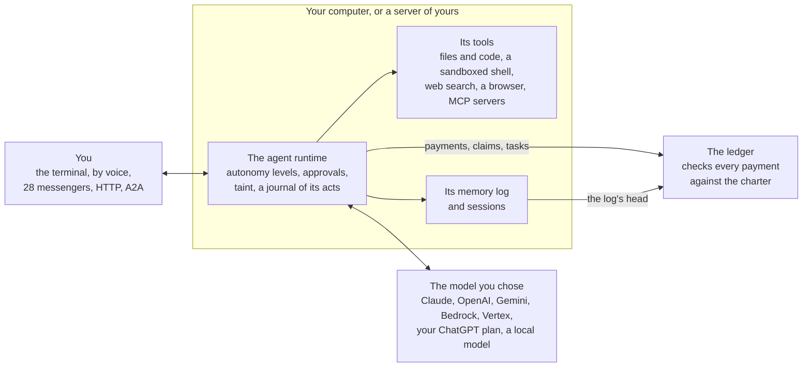
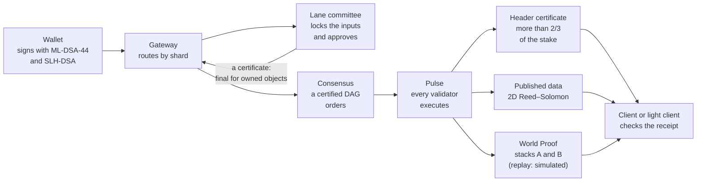

<p align="center">
  <picture>
    <source media="(prefers-color-scheme: dark)" srcset="brand/logo/siontology-lockup-on-dark.svg">
    
  </picture>
</p>

<p align="center">
  An AI agent you run yourself, on a ledger that holds it to its limits.
</p>

<p align="center">
  <a href="https://github.com/shayansal/Siontology/actions/workflows/ci.yml"></a>
  
  
  
</p>

Siontology is an **AI agent you run yourself**: in the terminal, by voice
and on 28 messaging services, with a browser, tools for code, a sandboxed
shell, memory and skills. It takes on work from the GitHub repositories
and chats it watches, sells its work to other agents and buys from them
through ACP, AP2 and x402, and can be rented out by the token from an
enclave its renters can check.

What makes it different is underneath: **a ledger of its own**, a
neo-blockchain, that checks every payment against the agent's charter,
keeps the history of its memory, and pays for work only when it passes a
rule fixed in advance. A payment the charter forbids is refused, whatever
the agent was told. The ledger is a reference implementation, in Rust and
at devnet scale, of the architecture in
[*Neo-Blockchains: The Fold Architecture*](docs/book/src/papers/architecture.md):
a network whose product is verified knowledge, where every claim carries
a proof or priced evidence that, by design, a phone can check.

> **Status.** A devnet-scale reference implementation. The agent is tested
> with scripted models and stand-ins for the services it talks to, and no
> release is published yet. The ledger's validity proofs are *replay
> proofs* that stand in for succinct ones, its validators run in one
> process (or as separate processes on one machine, over QUIC), and it
> secures nothing of value. Card payments run against a simulated acquirer
> and 3-D Secure issuer.
> [`docs/implementation-status.md`](docs/implementation-status.md) says
> what is built, simplified, simulated or missing; every document here
> keeps to it. Siontology has no token and nothing is on offer. Fees are
> paid in stablecoins.

**Contents:** [Get started](#get-started) · [The agent](#the-agent) ·
[Selling, buying and renting](#selling-buying-and-renting) ·
[The ledger underneath](#the-ledger-underneath) · [The app](#the-app) ·
[What exists today](#what-exists-today) · [Demos](#demos) ·
[The repository](#the-repository) · [Documentation](#documentation) ·
[Development](#development) ·
[Security, contributing and licence](#security-contributing-and-licence)

## Get started

### Run an agent of your own

```bash
git clone https://github.com/shayansal/Siontology && cd Siontology
sh scripts/install.sh   # builds sion from this checkout, into ~/.local/bin
sion setup              # a chain of your own, your wallet and your agent's, a model, a profile
sion                    # talk with it; sion -c continues the last conversation
```

Building needs Rust 1.80 or later and a C compiler; `sion doctor` says what
else the machine has. [Run it on your
computer](docs/book/src/getting-started/your-computer.md) walks through
setup, and [Your agent](docs/book/src/agent/index.md) says what the agent
can do.

### What to try next

| To | Run | Read |
|---|---|---|
| Reach it on a messenger | `sion agent bridge <profile> --via telegram` (or slack, discord, signal, whatsapp, …) | [Channels](docs/book/src/agent/channels.md), [Messengers](docs/book/src/agent/messengers.md) |
| Let it take on work from GitHub | `sion agent work watch …`, then `sion agent work run` | [Work it takes on by itself](docs/book/src/agent/work.md) |
| Keep it running on a server of yours | `sion deploy <user@host>`, which runs everything there with `sion agent up` | [Run it on a server](docs/book/src/agent/server.md) |
| Sell its work to other agents | `sion agent sell serve catalog.json --pay-to <wallet> --name …` | [Selling and buying](docs/book/src/agent/commerce.md) |
| Rent it out by the token | `sion agent rent serve <profile> --name … --per-1k-input … --per-1k-output …` | [Renting your agent out](docs/book/src/agent/renting.md) |
| Connect another AI agent over MCP | `sion mcp` | [MCP](docs/book/src/getting-started/mcp.md) |
| Run every scripted demo of the ledger | `sion demo all --local` | [Run the demos](docs/book/src/getting-started/demos.md) |
| Check the chain as a light client | `sion verify --chain <identity>` | [Light client](docs/book/src/getting-started/light-client.md) |

### Try the ledger on its own

```bash
cargo build --release
alias sion=./target/release/sion
sion devnet                          # 4 validators, 2 shards, the API on 127.0.0.1:8730
sion keys new dana                   # a wallet in ~/.sion/wallets (or $SION_HOME/wallets)
sion faucet dana 100
sion send dana alice 12.5            # prints the sentence it signs, then the outcome
sion verify --chain <the identity sion devnet printed>
```

## The agent



What is enforced, and where:

| What | Where it is enforced |
|---|---|
| What the agent tries: its autonomy level, approvals, taint, quarantine, confidential files | The runtime, on your machine (trust atom `agent:local-policy`) |
| What it can do with money: its budget, its largest payment, whom it may pay, how fast it spends | The ledger: validators check every payment against its charter, whatever the runtime allowed |
| What it remembers | Its memory log on your machine, whose head the ledger keeps and lets only grow |
| Where its conversation goes | The model provider you chose, which sees it (trust atom `agent:provider-sees-context`) |

### Where you reach it

- **The terminal**, typed, by push-to-talk or live: it speaks as it
  writes, takes its own voice out of what the microphone hears, stops when
  you talk over it, can wait for a wake word, and tells when you have
  finished by what you said. Speech runs through a service or on your
  machine (whisper.cpp, Piper). Tested with stand-ins for the microphone
  and the speech services; no microphone or loudspeaker was used.
  [Voice](docs/book/src/agent/voice.md)
- **28 messaging services**, from Telegram, Slack, Discord, Signal,
  WhatsApp and email to Teams, WeChat, Matrix, Nostr and phone calls, with
  voice notes, pairing for people it does not know yet, and approvals
  asked in the chat. X's mentions are answered with their sources.
  [Messengers](docs/book/src/agent/messengers.md)
- **HTTP and other agents**: its own API, OpenAI's chat completions API
  (a profile as the model), and A2A.
  [Channels](docs/book/src/agent/channels.md)
- **Meetings**: it takes notes by phone, on your machine, or as a guest
  that joins by the meeting's link, with who said what when a transcriber
  that tells speakers apart is given (`--diarize`). Given a voice
  (`--speak`), the guest answers what is asked of it by name. Tested
  against stand-in meeting pages and services: Meet, Zoom, Teams and
  Twilio were not reached, and the guest's voice was not run with a sound
  server.
  [Voice](docs/book/src/agent/voice.md#meeting-notes)

### What it works with

- Files and code: it edits, patches, searches, checks and tests, and its
  subagents work in git worktrees of their own.
- A shell in a sandbox, web search, and a browser with tabs, downloads and
  uploads. Given your browser profile it is signed in as you, and it hands
  you the page for a captcha or a code. It also has a desktop of its own,
  used with the pointer and in code, and a canvas where it shows you what
  it works on and hears what you press.
  [Browser](docs/book/src/agent/browser.md), [Canvas](docs/book/src/agent/canvas.md)
- MCP servers over standard input and output or HTTP with OAuth, with
  their resources, prompts, sampling and questions to you; and sion's own
  servers for mail, calendars and documents.
  [Tools](docs/book/src/agent/tools.md)
- Programs it writes that call its tools that only read, run in the
  sandbox; a search over a large toolbox; your hooks before and after its
  calls.
- A web identity, if you make one: what it fetches from the web is signed
  (Web Bot Auth, an IETF draft), so that a site can tell whose agent
  asks. Tested against the draft's test vector, not against sites.
  [A web identity](docs/book/src/agent/tools.md#a-web-identity)

### Within limits, and checked

- Autonomy levels from L0 to L6, approvals, taint from what comes from
  outside, quarantine, confidential files that commands are not shown,
  signed decisions, a journal of everything it did, and attacks reported
  between operators on a bond, whose text every agent that trusts the
  report holds back.
  [What it does alone](docs/book/src/agent/autonomy.md),
  [Security](docs/book/src/agent/security.md)
- Checks a run must pass before it is done, budgets for time and tokens,
  and detection of a run that is stuck. With `--expect` the agent says
  what it expects of a call before it makes it, is told where the call
  went otherwise, and `sion agent improve` is shown what it did not
  expect on its tasks; tested with scripted models only.
  [Checked before it is done](docs/book/src/agent/checks.md),
  [What it expected](docs/book/src/agent/checks.md#what-it-expected)
- A charter on the ledger for its money: payees, largest payment, rate of
  spending, expiry. [A run, within its limits](docs/book/src/agent/run.md)
- A record of the agent for whoever is asked to stand behind it: what
  the ledger shows of what it did, which anyone can recompute, apart
  from what its operator says; and a warranty on a bond that a
  counterparty is compensated from.
  [Its record, and a warranty](docs/book/src/agent/record.md)
- Zero-knowledge proofs, off the ledger, that payments you do not show
  kept their limits and that a record's figures meet a threshold.
  [Proving rules were kept](docs/book/src/agent/proofs.md)
- Sealed exams: tasks encrypted and committed to on the ledger, agents
  entered before a threshold of trustees opens them, and results anyone
  can run again. [Sealed exams](docs/book/src/agent/exams.md)
- Receipts for which model answered each call: the model asked for, the
  address and the model the provider named, in a chain an operator
  commits to in a claim or a rented agent's enclave signs.
  [Receipts](docs/book/src/agent/receipts.md)
- A market for agents' work: sealed bids in rounds, each cleared at one
  price that anyone can recompute from the ledger, and a Task Charter
  per unit that pays a worker for an accepted result.
  [A market for agents' work](docs/book/src/agent/market.md)
- A flight recorder for an agent that drives a machine: its events
  recorded with no network, fixed by commits to the ledger, handed to an
  investigator as an extract that checks, with bounds proven of readings
  that are not shown.
  [A flight recorder](docs/book/src/agent/recorder.md)
- Datasets of checked work: sessions their owners contribute on stated
  terms, each with what checked the work in it (a Task Charter the
  ledger settled, or the session's own check), built into versions that
  whoever trains on them checks against the ledger.
  [Datasets of checked work](docs/book/src/agent/dataset.md)
- Benchmark suites built in, for paying over x402, attacks on an agent
  that pays, confirming before paying and prompt injection, run with your
  models and stand-in tools; a run can be published on the ledger as a
  signed claim and checked against its log. Tested with stand-in models
  only. [Agent benchmarks](docs/book/src/agent/benchmarks.md)

### What it knows, and how it gets better

- **Memory**: a log whose head the ledger keeps, search over past
  sessions, search by meaning with an embedder you name, consolidation,
  and dreaming whose results are kept only when they pass.
  [Memory](docs/book/src/agent/memory.md)
- **Skills** in the Agent Skills format: its own, written as it works or
  taught by doing a task once in a browser; others', installed when bonds
  and audits cover what they could cost, or imported from a folder, a
  repository, ClawHub or skills.sh after an audit of their files; each
  held to the permissions it declares.
  [Skills](docs/book/src/agent/skills.md),
  [What a skill may do](docs/book/src/agent/skill-permissions.md)
- **Skills that get better**: measured against an evaluation set, evolved,
  and released again on the attestations of verifiers fixed in advance.
  [Skills that get better](docs/book/src/agent/skill-improvement.md)
- **An agent that gets better**: `sion agent improve try` tries changes
  you give it (words in its instructions, the models a route reaches for,
  a vote) and keeps one only when it is better beyond chance on a set of
  tasks and fails no held-out task the agent passed, with the evidence.
  [Improving the agent](docs/book/src/agent/skill-improvement.md#improving-the-agent-not-only-a-skill)
- **An agent that improves itself**: its sessions, marked or checked,
  become tasks; part of them is sealed on the ledger before anything is
  tried. `sion agent improve run` lets a model write the agent's changes
  from the failures it is shown, and keeps one only when it is better
  beyond chance on the sealed tasks, which nothing that writes changes is
  shown. The improver improves itself the same way. Changes to the agent's
  own code are built, tested and scored in a sandbox, released on the
  ledger, rebuilt and attested by others (on a bond an adjudicator can rule
  against, when they choose), and installed only by you. The sealed tasks
  can be a reusable holdout, a model can write practice tasks to choose
  changes on, and a challenger can write variants of what a change newly
  passes to catch a shortcut before it is confirmed. A lesson one owner's
  agent kept can be shared on a bond, and another owner's agent keeps it
  only when its own sealed tasks confirm it. Tested with scripted
  models. [Improving itself](docs/book/src/agent/self-improvement.md)
- **On Ethereum and in what it makes**: the agent's ERC-8004 registration
  file, naming its DID, and the calls that register it and bind its wallet,
  written for a wallet to send; Content Credentials (C2PA) for the files it
  makes, signed with your certificate.
  [ERC-8004](docs/book/src/agent/erc8004.md), [C2PA](docs/book/src/agent/c2pa.md)
- **Facts shared between owners**: a log another owner curates, kept in
  mind, each fact vouched for on someone's bond or revoked by its writer (a
  voucher withdraws only its own vouching); a revoked fact, and whatever
  was drawn from it, leaves the prompt. [Memory](docs/book/src/agent/memory.md#facts-from-other-owners-who-vouched-and-pulling-one-back)
- **Models**: Claude, OpenAI, Gemini, your ChatGPT plan, a local model,
  AWS Bedrock, Google Vertex AI, Azure OpenAI or nine providers by name
  (OpenRouter, DeepSeek and others), with fallback, their reasoning kept across tool calls, how hard each
  thinks set per model, and a model for each kind of task, chosen by rule
  or by a small model and compared on your own tasks.
  [Models](docs/book/src/agent/models.md)

### Help, and work of its own

- **Subagents** with budgets carved from its own, keyless ones signed for
  in batches; **hired agents** paid through Task Charters; and **graphs of
  agents** (fan-out, work-check, draft-review, self-consistency, an
  orchestrator, or one of your own).
  [Subagents and hired help](docs/book/src/agent/teams.md),
  [Graphs](docs/book/src/agent/graphs.md)
- **Work it takes on by itself**: it watches GitHub repositories and
  chats, a fixed gate decides what it may take on, every piece of work has
  a mandate on the ledger, it follows its pull requests' reviews and
  failed checks, and what needs you waits on one list.
  [Work](docs/book/src/agent/work.md)
- **Projects that run for weeks**: a goal, a budget each of its payments
  is held to before it is sent, milestones, and check-ins that report what
  was done since the last one, saying so when it was nothing.
  [Projects](docs/book/src/agent/work.md#projects-that-run-for-weeks)
- **Finding an agent for a task**, among those you name: how well each
  one's offer fits, weighed against its record on the ledger, held to an
  enclave that checks out or a price.
  [Finding one](docs/book/src/agent/teams.md#an-agents-record-and-finding-one-for-a-task)
- **Schedules and profiles**, and an agent brought over from OpenClaw or
  Hermes Agent: its persona, memories, jobs, models, keys and chats, with
  a plan shown first.
  [Profiles and schedules](docs/book/src/agent/schedules.md),
  [Import](docs/book/src/agent/import.md)
- **Where it runs**: your computer, or a server of yours, with one process
  that keeps everything running.
  [Run it on a server](docs/book/src/agent/server.md)


## Selling, buying and renting

Agents pay each other, and the ledger is where it is checked.

| What | How | Read |
|---|---|---|
| Sell through ACP | `sion agent sell serve` serves the Agentic Commerce Protocol (2026-04-17): checkout, carts, orders sent by signed webhooks, request signatures, product feeds. A session is paid on the ledger, the order made once the payment's receipt verifies, or by a card delegated to the merchant's PSP or Stripe, with 3-D Secure. Its state is kept across restarts. | [Selling and buying](docs/book/src/agent/commerce.md) |
| Buy, under the user's mandates | `sion agent buy` pays an ACP merchant on the ledger or by card, within a cap. AP2 v0.2 mandates say what it may buy and pay, rooted in keys or certificate chains the merchant trusts (a certificate's revocation is not checked), recurring payments counted against their limits. | [AP2 mandates](docs/book/src/agent/commerce.md#ap2-mandates) |
| Pay per request | x402: an API answers `402`, the agent pays under its charter and retries (`fetch_paid` in an agent's own runs, `sion x402 fetch` from the command line). Payment streams pay by revealing one hash a request, settled in a few transactions. | [x402](docs/book/src/guides/x402.md), [Streams](docs/book/src/guides/streams.md) |
| Rent an agent out | Listed by the token from an AMD SEV-SNP enclave whose attestation the renter checks before sending anything; requests sealed to the enclave; paid through a stream for the tokens the enclave signed for; its sessions hold none of the owner's memory, files or reach. | [Renting](docs/book/src/agent/renting.md) |
| Let other frameworks check | Public reads, without a token: an agent's record from the ledger's events, a transaction's outcome with how to verify its receipt, and a rental listing with whether its enclave checks out. | [Its record, for anyone to read](docs/book/src/agent/work.md#its-record-for-anyone-to-read) |

Checked against outside work: 34 requests and answers from a live run
meet ACP's published JSON Schemas, and AP2's own example tokens verify
([`scripts/interop`](scripts/interop/README.md)). Card payments here move
no money: the PSP's acquirer and the 3-D Secure issuer are simulated. The
Stripe path was tested against a stand-in for Stripe's API. Renting ran
end to end with a simulated enclave: no AMD hardware was reached, and
building and launching the confidential VM itself is not built.

## The ledger underneath

Blockchains chain blocks; DAGs link transactions; neo-blockchains **fold
claims**. Four pieces carry the design:

| Piece | In one sentence | Read |
|---|---|---|
| Two-sorted state | Knowledge never needs coordination; only the consumption of resources is ordered, and only among contenders. | [Two-sorted state](docs/book/src/concepts/two-sorted-state.md) |
| The Assurance Algebra | Every claim carries a formula of its assumptions; anyone computes what an attacker must forfeit to falsify it, relies on it only when that exceeds what is at stake, and reserves that backing. | [The Assurance Algebra](docs/book/src/concepts/assurance/index.md) |
| Verifiable Clearing | A market clearing is valid only with a certificate that no better allocation exists, checked in linear time. | [Verifiable Clearing](docs/book/src/concepts/verifiable-clearing.md) |
| The Fold | Every proof folds into one World Proof per Pulse, so a phone can verify the whole history (here, replay proofs stand in for the succinct ones that needs). | [The Fold](docs/book/src/concepts/the-fold.md) |

Why it matters for agents: AI made producing text, code and decisions
nearly free, and checking them did not get cheaper. Blockchains make one
thing trustworthy, their own ledger state; a neo-blockchain extends
verifiable trust to anything that can carry evidence, and puts a price on
evidence that is not a proof. For an agent, that means limits that hold
even when the agent is fooled:

- a **charter** the validators check on every payment (whom it may pay,
  its largest payment, how fast it may spend, until when);
- **memory** whose past cannot be rewritten unnoticed: the ledger keeps
  its log's head and lets it only grow;
- **work** paid only for a result that passes a rule fixed when the work
  was posted;
- **skills from others** installed only when bonds and audits cover what
  they could cost.

A transfer, `sion send dana alice 12.5`, goes through the code like this
(each step's module is named in
[A transaction, from wallet to receipt](docs/book/src/architecture/transaction-flow.md)):



Around the four pieces:

- **Ordering only where it is needed.** An owned object is final once its
  shard's committee certifies the spend, with no consensus round
  ([Linear Lanes](docs/book/src/concepts/linear-lanes.md)). Shared totals
  split into single-writer allotments
  ([Escrow Lanes](docs/book/src/concepts/escrow-lanes.md)). Only contended
  objects go through consensus
  ([Contention Consensus](docs/book/src/concepts/contention-consensus.md)).
- **Agents as identities.** An [Agent Charter](docs/book/src/concepts/agent-charters.md)
  fixes an agent's payees, its largest payment, a spending rate carved down
  its tree of subagents, an expiry and the evidence a payment needs; a
  charter only narrows when delegated, and suspending one stops the whole
  tree. Subagents can be keyless, their nearest keyed ancestor signing up to
  256 of their transactions at once
  ([Batched authorization](docs/book/src/concepts/batched-authorization.md)).
- **Post-quantum from the start.** Every authorization carries signatures
  from two unrelated families, ML-DSA-44 and SLH-DSA-SHA2-128f, so a forger
  must break both; payloads are sealed with ML-KEM-768
  ([Post-quantum identity](docs/book/src/concepts/post-quantum.md)).
- **Data you can check is there.** Each Pulse's data is published with 2D
  Reed–Solomon coding; a light client samples it at random, and a bad
  encoding has a fraud proof
  ([Data availability](docs/book/src/concepts/data-availability.md)).
- **Censorship you can see.** A user the gateway ignores posts straight to
  consensus; the shard then owes the transaction, and every certified header
  counts what a shard owes, so a censoring committee is visible to every
  light client, and replaced
  ([Censorship resistance](docs/book/src/concepts/censorship-resistance.md)).
- **Who certifies is part of the state.** Validators stake, earn fees by
  stake and are slashed for signing two headers for one round; committees
  change only at epoch boundaries, by rules the World Proof covers
  ([Validators, staking and epochs](docs/book/src/concepts/committees.md)).
- **Payments, memory, work and storage.** Payment streams pay by revealing
  a hash chain, one hash a payment
  ([Payment streams](docs/book/src/concepts/payment-streams.md)); memory
  logs for agents and robots keep their heads on the ledger
  ([Memory](docs/book/src/concepts/memory.md)); Task Charters escrow work
  whose acceptance is fixed when it is posted
  ([Task Charters](docs/book/src/concepts/task-charters.md)); storage deals
  pay devices to keep data, proven every round
  ([Storage deals](docs/book/src/concepts/storage.md)).

## The app

[`apps/sion-app`](apps/sion-app) turns a device into a light node: a Tauri
shell over [`sion-app-core`](crates/sion-app-core), which keeps the
device's key, checks the device's own receipts as a light client, pays,
and provides storage from the device for storage deals. The desktop shell
is built and run (its Agents tab, added later, only type-checked); the
Android and iOS builds are configured, not built.
[The app](docs/book/src/getting-started/app.md)

## What exists today

[`docs/implementation-status.md`](docs/implementation-status.md) is the
authority, with every simplification and the trust assumptions the
implementation adds. In short:

- **Built**, at devnet scale and with tests: two-sorted state; post-quantum
  accounts; Agent Charters, agent identities, subagents and batched
  authorization; Linear and Escrow Lanes; committees, epochs, staking and
  slashing; two levels of finality; two independent proof stacks; claims
  and the Assurance Algebra; Verifiable Clearing; encrypted payloads,
  viewing keys and sealed orders; data availability coding, sampling,
  reconstruction and fraud proofs; payment streams, memory logs, Task
  Charters and storage deals; the CLI, the HTTP API and the MCP server;
  work the agent takes on by itself; renting an agent out and agents'
  records; improving the whole agent, projects, vouched and revoked shared
  memory, and finding an agent for a task (with scripted models; the
  meeting guest's voice is wired but its microphone was not run); the
  agent improving itself from its own work, the improver improving
  itself, and changes to its own code released and attested (with
  scripted models, and for code a small harness in Python; not yet run on
  this repository's own code).
- **Partly built**: the agent runtime (tested with scripted models and
  stand-ins for the services it talks to); the adapters for outside protocols
  (x402, ACP and AP2 are built, with card networks simulated; ERC-8004's
  registration file and calls are written for a wallet to send, and C2PA
  manifests are sidecars signed ES256); the app (the desktop shell is built
  and run; mobile is configured, not built).
- **Simplified**: consensus is a certified DAG, not an uncertified one;
  forced inclusion replaces a censoring committee but does not freeze the
  shard; data retention and archival; networking between machines (QUIC
  between processes, peers from files, tested on one machine).
- **Simulated**: validity proofs. A World Proof is checked by replaying the
  Pulse in two independent stacks, a stand-in for succinct proofs, with
  real bindings to the state, receipts, data and certificates
  (`impl:replay-proofs`).
- **Not built**: personhood claims, a proving market, confidential amounts
  and zero-knowledge compliance, payments to provers and the
  value-in-flight cap.

<details>
<summary>The status of every section of the architecture</summary>

| Architecture section | Status |
|---|---|
| Foundations: two-sorted state, derived coordination class | Built |
| Identity: post-quantum accounts | Built |
| Identity: personhood | Not built |
| Identity: Agent Charters | Built |
| Identity: agent identities and subagents | Built (devnet scale) |
| Identity: batched authorization and keyless subagents (beyond the paper) | Built (devnet scale) |
| Agents: a runtime that lets a model work as an agent identity, within its charter: models, tools, autonomy and approvals, memory, skills, channels and voice (beyond the paper) | Partly built (tested with scripted models and stand-ins for the services it talks to) |
| Agents: work it takes on by itself from GitHub and chats, under mandates on the ledger, its pull requests' reviews and checks followed (beyond the paper) | Built (devnet scale; tested against stand-ins for GitHub and Telegram) |
| Agents: renting by the token from an attested enclave, agents' records, public reads for other frameworks (beyond the paper) | Built (devnet scale; renting run end to end with a simulated enclave, no AMD hardware reached; the public reads tested in units) |
| Agents: improving the whole agent, projects, memory shared with vouching and revocation, a meeting guest that speaks, finding an agent for a task (beyond the paper) | Built (devnet scale; tested with scripted models; the meeting guest's voice wired and tested in units, its microphone and a meeting not run) |
| Agents: improving itself from its own work — changes it writes, tasks from its sessions sealed on the ledger, the improver improving itself, changes to its own code released and attested (beyond the paper) | Built (devnet scale; tested with scripted models, and for code with a small harness in Python in bubblewrap; not run on this repository's own code, nor with a real model) |
| Data availability: 2D Reed–Solomon, sampling, reconstruction, fraud proofs | Built |
| Data availability: retention and archival | Simplified |
| Ordering: Linear Lanes (owned objects) | Built |
| Ordering: Escrow Lanes (bounded shared totals) | Built |
| Ordering: Contention Consensus | Simplified (certified DAG, not uncertified) |
| Ordering: censorship resistance (forced inclusion) | Simplified (obligations and committee rotation; the shard is not frozen) |
| Ordering: committees, epochs and staking | Built (devnet scale) |
| Ordering: two levels of finality | Built |
| Execution: prove heavy, execute light | Simulated (replay proofs) |
| Execution: N-version proving | Built (two independent replay stacks) |
| Execution: proving market | Not built |
| The Fold: World Proof per Pulse | Simulated (replay proofs, real bindings) |
| Knowledge layer: claims and the Assurance Algebra | Built |
| Verifiable Clearing | Built |
| Privacy: encrypted payloads, viewing keys, sealed orders | Built |
| Privacy: confidential amounts, zero-knowledge compliance | Not built |
| Interfaces: CLI, HTTP API, MCP server for agents | Built |
| Interfaces: x402, AP2, ERC-8004, C2PA adapters | Partly built (x402; AP2 and ACP; card networks simulated; ERC-8004's registration file and calls, written for a wallet to send; C2PA sidecar manifests, ES256) |
| Interfaces: the app, a light node on every device (beyond the paper) | Partly built (desktop shell built and run; mobile configured, not built) |
| Payments: streams with checkpoint settlement (beyond the paper) | Built (devnet scale) |
| Memory: logs for agents and robots, kept append-only by the ledger (beyond the paper) | Built (devnet scale) |
| Orchestration: Task Charters, escrowed work with acceptance fixed at posting (beyond the paper) | Built (devnet scale) |
| Economics: fees, treasury, slashing with compensation | Built |
| Economics: staking, rewards, equivocation slashing | Built |
| Economics: storage deals, devices paid to keep data and prove it every round (beyond the paper) | Built (devnet scale) |
| Economics: payments to provers, value-in-flight cap | Not built |
| Networking between machines | Simplified (QUIC between processes, peers from files; a stopped validator cannot rejoin) |
</details>

## Demos

`sion demo <name>` drives real transactions through the whole protocol
(lane certificates, consensus, Pulse execution, header certificates, data
availability and proving) and narrates what the ledger established;
`sion demo all --local` runs them all against an in-process devnet. See
[Run the demos](docs/book/src/getting-started/demos.md).

| Demo | What it shows |
|---|---|
| `invoice` | Trade finance on insured knowledge: a buyer's acceptance of invoice #1042 is a bonded claim; a financier prices it with the Assurance Algebra, relies on it within its backing, and is compensated from the slashed bond when the claim proves false. |
| `agents` | An AI agent with a budget the ledger enforces: a payment to an unlisted payee and an over-limit payment are refused; revoking the charter stops the agent and its sub-agent. |
| `swarm` | Agent identities: an orchestrator launches 12 researchers in one transaction and one of them launches 3 of its own, each with its own identity, account and budget; 15 pay at once without consensus; one suspension stops the whole tree and one resumption restarts it. |
| `batch` | Batched authorization: an orchestrator launches 64 keyless subagents in one transaction and signs one batch for a payment from each; each member pays a lower fee because the signature check is shared, and nobody else can sign for them. |
| `tasks` | Task Charters: an eval orchestrator posts work from its budget; a result is paid only when it rests on the environment's claim and enough attested backing, and only once; a bounty is settled and another withdrawn; an exploit in the grader is proven and the lab is compensated from the vendor's bond. |
| `robots` | Memory for robots: two robots with their own identities and memory logs share a warehouse; a reader checks complete answers against the heads on the ledger; a rewrite is refused; a curator's refutation gives two readers two provable beliefs; an index that leaves an atom out is convicted; a camera frame is forgotten; a suspended robot's memory stops growing. |
| `storage` | Storage deals: a robot commits its memory log with its archive's root as the manifest and pays a laptop to keep the archive, proven every round; a phone that kept only half of the footage it accepted cannot answer the challenges and forfeits its collateral. |
| `market` | A sealed-bid GPU-hour market that clears at one price with an optimality certificate. |
| `receipts` | Verifiable AI inference receipts: each consumer prices the same receipt under its own assumptions (trusting a TEE, distrusting it, or assuming it broken). |
| `x402` | An AI agent pays an HTTP API per request with x402: the API answers `402`, the agent pays under its charter and retries, and the API serves once the receipt verifies; a replayed payment and an over-limit payment are refused. |
| `streams` | An agent pays an API 2,000 times from one payment stream: the server checks one hash per call and sends no transaction per call; two to four settlements, proven by checkpoint, cover all of them; an auditor checks a call's receipt against the ledger. |
| `censorship` | Forced inclusion: a user censored by the gateway gets through by posting straight to consensus; when more than a third of a committee censors too, the shard misses its deadline, its committee is replaced, certified headers count the overdue intent and a light client sees it. |
| `light` | A light client pins the chain identity, verifies the latest Pulse end to end and catches a node that serves substituted validator keys. |
| `staking` | A standby validator stakes and joins the active set at the next epoch boundary, a light client follows the committee change from genesis, rewards are claimed, and the newcomer is slashed for signing two headers for one round and loses its seat. `--local` starts a devnet with a standby validator and 24-Pulse epochs; against your own devnet, start it with `--standby 1 --epoch-length 24`. |

## The repository

One Cargo workspace of nineteen crates; each has a README of its own.
Lower crates know nothing of higher ones
([Crate map](docs/book/src/architecture/crates.md),
[Architecture](ARCHITECTURE.md)).

| Crate | What it holds |
|---|---|
| [`sion-core`](crates/sion-core) | Domain-separated SHA3-256, canonical Borsh encoding, typed identifiers, fixed-point money, the RFC 9162 append-only log, the sparse Merkle state tree |
| [`sion-crypto`](crates/sion-crypto) | ML-DSA-44, SLH-DSA-SHA2-128s/128f, ML-KEM-768, dual-origin signatures, account policies, sealed envelopes, Shamir sharing |
| [`sion-assurance`](crates/sion-assurance) | The Assurance Algebra: atoms, formulas, cost of corruption, the decision rule, reservations, challenges, slashing, insurance |
| [`sion-lp`](crates/sion-lp) | Exact rational simplex, and linear-time checks of optimality certificates |
| [`sion-clearing`](crates/sion-clearing) | Verifiable Clearing: sealed double auctions and assignment markets with certificates |
| [`sion-da`](crates/sion-da) | 2D Reed–Solomon over the Goldilocks field, commitments, sampling, reconstruction, fraud proofs |
| [`sion-consensus`](crates/sion-consensus) | Linear Lanes, the certified-DAG BFT core, committees and sampling, the beacon, forced inclusion, a deterministic network simulator |
| [`sion-exec`](crates/sion-exec) | The state machine: objects, accounts, claims, bonds, charters, agent identities, escrow, markets, streams, memory heads, tasks, validators, storage deals; Pulse execution with traces and witnesses |
| [`sion-spec`](crates/sion-spec) | Proof stack B: the state transition written again, independently, from [the specification](docs/spec/state-transition.md) |
| [`sion-prover`](crates/sion-prover) | Proof stacks, World Proofs and their verification |
| [`sion-light`](crates/sion-light) | The light client: chain identity, header certificates, committees from epoch to epoch, proofs, availability sampling |
| [`sion-memory`](crates/sion-memory) | Memory for agents and robots, off the ledger: atoms, single-writer logs, a 4D index with range, subject, link and omission proofs |
| [`sion-net`](crates/sion-net) | Networking between processes: QUIC with TLS 1.3, X25519MLKEM768 and pinned ML-DSA-44 keys, bounded queues and quotas |
| [`sion-http`](crates/sion-http) | Outbound HTTPS for clients, X25519MLKEM768 offered first, refusing addresses that are not public |
| [`sion-agent`](crates/sion-agent) | The agent runtime: models, tools with effects, autonomy and approvals, taint, the journal, budgets, the sandbox, the browser, MCP, skills, schedules, graphs |
| [`sion-enclave`](crates/sion-enclave) | Attestation for agents in enclaves: AMD SEV-SNP reports checked against AMD's chain, the session's keys bound in them, a simulated platform for tests |
| [`sion-zk`](crates/sion-zk) | Zero-knowledge proofs about committed numbers: linear rules over amounts and membership in a list, for showing third parties that rules were kept; not used by consensus |
| [`sion-node`](crates/sion-node) | The devnet and `sion node`: validators, the gateway, the prover, the write-ahead log and snapshots, the HTTP API |
| [`sion-cli`](crates/sion-cli) | The `sion` command: the devnet and nodes, wallets, the ledger's commands, the agent's channels, messengers, voice, work, renting, ACP and AP2, its own MCP servers, setup, deploying, demos |
| [`sion-app-core`](crates/sion-app-core) | The app's core: the device's key, a light client for the device's own receipts, payments, storage provided from the device |

Besides the crates:

| Folder | What it holds |
|---|---|
| [`apps/sion-app`](apps/sion-app) | The app: a Tauri shell over `sion-app-core`, its own Cargo workspace |
| [`docs`](docs) | The book, the specification, the implementation status and plan ([index](docs/README.md)) |
| [`examples/mcp-notes`](examples/mcp-notes) | A small MCP server, in Python's standard library, that the book's tool chapter uses |
| [`skills/starter`](skills/starter) | The starter skills `sion skill starter` installs |
| [`deploy`](deploy) | A compose file that runs `sion agent up` in a container |
| [`scripts`](scripts) | The installer, the release tooling, and checks against other implementations of ACP and AP2 ([`scripts/interop`](scripts/interop/README.md)) |
| [`packaging`](packaging) | A Homebrew formula (the Nix flake is `flake.nix`, the image's `Dockerfile` is at the root) |
| [`site`](site) | The website's source and its generated pages |
| [`brand`](brand) | The logo, colours and type, with their [guidelines](brand/guidelines.md) |

## Documentation

- **[The documentation index](docs/README.md)**: everything below, with a
  line on each.
- **[The Siontology book](docs/book/src/SUMMARY.md)**, 117 pages: getting
  started, your agent, building on the ledger, running a network, the
  concepts, a reference for the CLI, the HTTP API, the MCP tools and the
  transaction kinds, the architecture of the code, research and the
  security model, with a [glossary](docs/book/src/project/glossary.md).
  `mdbook build docs/book` builds it.
- **[Architecture](ARCHITECTURE.md)**: a tour of the code for someone about
  to change it.
- **[State transition specification](docs/spec/state-transition.md)**
  (v1.15): the rules both proof stacks implement.
- **[Implementation status](docs/implementation-status.md)**: what is built,
  simplified, simulated or missing, and every trust assumption.
- **[Neo-Blockchains: The Fold Architecture](docs/book/src/papers/architecture.md)**:
  the architecture paper.
- **[Research](docs/book/src/research/index.md)**: billions of payments a
  second, billions of agents, succinct proofs, networking between machines,
  reliable agents; each says what is built, measured or only planned.
- **[Changelog](CHANGELOG.md)** and **[`AGENTS.md`](AGENTS.md)**, the rules for
  anyone, person or AI, who changes the code.

## Development

```bash
cargo fmt --all
cargo clippy --workspace --all-targets -- -D warnings
cargo test --workspace                        # the fast suite, which CI runs on every push
cargo test --workspace -- --include-ignored   # with the demos, which take minutes (nightly in CI)
```

The rules in [`AGENTS.md`](AGENTS.md) hold everywhere: every
consensus-critical value has one canonical encoding (Borsh) and a
domain-tagged hash; consensus-critical maps are ordered (`BTreeMap`); no
floating point in consensus logic, money being micro-units in a `u128`;
nothing is deleted from state; every trust assumption is named; simulation
shortcuts are labelled in the types; and there is no unsafe Rust.

The tests include property tests for the Assurance Algebra, the linear
programming certificates, the state machine and the commerce code; a
deterministic consensus simulator with adversarial network phases; a
scenario for every transaction kind; differential tests between the two
proof stacks; end-to-end devnet tests with dual post-quantum signatures;
the agent's runs against scripted models and stand-ins for the services it
uses; and the demos. At the time of writing the crates hold about 225,000
lines of Rust under their `src/` folders and 53,000 more in their `tests/`
folders, with about 1,290 test functions besides the property tests.

## Security, contributing and licence

- Security issues: see [SECURITY.md](SECURITY.md), and please do not open
  public issues for vulnerabilities. The [trust model](docs/book/src/security/trust-model.md)
  and [threat model](docs/book/src/security/threat-model.md) say what is
  assumed and defended.
- [Contributing](CONTRIBUTING.md) · [Code of conduct](CODE_OF_CONDUCT.md) ·
  [Governance](GOVERNANCE.md) · [Trademarks](TRADEMARKS.md) ·
  [Citation](CITATION.cff)
- Licensed under either of the [Apache License, Version 2.0](LICENSE-APACHE)
  or the [MIT licence](LICENSE-MIT), at your option. Unless you state
  otherwise, any contribution you submit for inclusion is licensed as
  above, without any additional terms or conditions.
