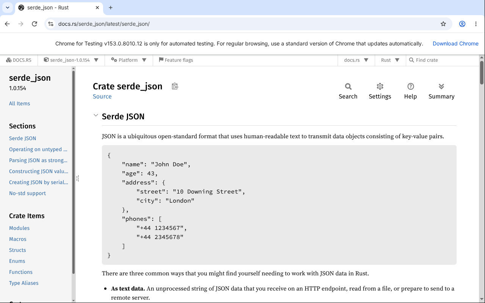

# A browser and a desktop

An agent can be given a browser of its own (`--browser`), to read and use
web pages as a person does, and a desktop of its own (`--computer`), seen
in screenshots and used with a pointer and a keyboard. Both run in a
sandbox, reach the network only through a proxy that refuses this machine
and its network, and bring back content from outside, which taints the
session ([Your agent](index.md)).

Every output below is from a real run on a local devnet, with a scripted
model, against docs.rs as it was then (long identifiers and paths
shortened with `…`).

## A browser

`--browser` gives a session Chromium or Chrome, found on this machine (or
named by `SION_BROWSER`), with a profile made for the session and removed
after it: none of your cookies, history or passwords, unless you give it
a profile you signed in with ([below](#signed-in-as-you)). On Linux it runs in
bubblewrap, which shows it the system's files read-only, its profile, and
the machine's managed browser policies (an administrator's certificates,
say), and nothing else of yours. It has no network of its own: every
connection goes through the egress proxy, to public addresses only, or
only to the hosts `--browser-host` names; never to this machine, its local
network or a cloud's metadata address.

The model sees a page as its accessibility tree: each element's role,
name and value, and a reference (`e12`) for each one it can act on. A
frame of the page's own site is shown where it is; a frame of another site
is named, not shown. Here an agent looks a crate up on docs.rs (each
result is shown cut to a screenful, as the command prints it):

```text
$ sion agent run coder 0f3d94ab…e058 --task 'What is the serde_json crate for? Look on docs.rs.' --model script:browse.json --browser --browser-host docs.rs --autonomy L5
session dbe45bdb119319ca for agent 0f3d94ab
  → browser_open {"url":"https://docs.rs/"}
  ← page https://docs.rs/
    title "Docs.rs"
    - RootWebArea "Docs.rs" focused
      - navigation "Main navigation" [ref=e1]
        - form [ref=e2]
          - link "Docs.rs" [ref=e3]
          - list [ref=e4]
            - listitem [ref=e5]
              - link "docs.rs" [ref=e6]
                - StaticText "▼"
          - list [ref=e7]
            - listitem [ref=e8]
    …
  → browser_type {"ref":"e11","submit":true,"text":"serde_json"}
  ← typed into e11
    page https://docs.rs/releases/search?query=serde_json
    title "Releases - Docs.rs"
    - RootWebArea "Releases - Docs.rs" focused
      - navigation "Main navigation" [ref=e1]
        - form [ref=e2]
          - link "Docs.rs" [ref=e3]
          - list [ref=e4]
            - listitem [ref=e5]
              - link "docs.rs" [ref=e6]
                - StaticText "▼"
          - list [ref=e7]
    …
  → browser_click {"ref":"e23"}
  ← clicked e23
    page https://docs.rs/serde_json/latest/serde_json/
    title "serde_json - Rust"
    - RootWebArea "serde_json - Rust" focused
      - navigation "Main navigation" [ref=e1]
        - form [ref=e2]
          - link "Docs.rs" [ref=e3]
          - list [ref=e4]
            - listitem [ref=e5]
              - link "serde_json-1.0.154 ▼" [ref=e6]
            - listitem [ref=e7]
              - link "Platform" [ref=e8]
    …
  → browser_screenshot {}
  ← a picture of https://docs.rs/serde_json/latest/serde_json/ ("serde_json - Rust")
    [a picture]
agent: serde_json is a JSON serialization file format, built on Serde; I took a picture of its page.
session dbe45bdb119319ca: done
```

The tools:

| Tool | What it does | Effect |
|---|---|---|
| `browser_open` | Opens a page (http or https) and returns its tree | external |
| `browser_snapshot` | The page as it is now | read |
| `browser_click` | Clicks an element, then returns the page | external |
| `browser_type` | Types into a field, replacing what it holds; with `submit`, presses Enter after | external |
| `browser_press` | Presses a key: Enter, Tab, Escape, Backspace, Delete, Space, the arrows, PageUp, PageDown, Home, End | external |
| `browser_scroll` | Scrolls about a screen, down or up | external |
| `browser_back` | Goes back a page | external |
| `browser_screenshot` | A picture of the page; with `marks`, each element of the last tree that is in view boxed and named on it (`e12`) | read |
| `browser_click_at` | Clicks at a point of the page as a screenshot shows it, for what has no reference (a canvas, a map), then returns the page | external |
| `browser_type_focused` | Types into whatever has the focus (after `browser_click_at`, say); with `submit`, presses Enter after | external |
| `browser_ask_person` | Hands the page to you, for what only you can do ([below](#handed-to-you)) | read |
| `browser_fill_login` | Fills one of your logins into a field ([below](#logins)) | external |

Where the tree says too little (a page drawn on a canvas, a control with
no name), the model looks: a screenshot with marks shows which reference
is where, at most 80 of them, the marks taken off the page again once the
picture is taken, and `browser_click_at` acts on a point of the picture,
in its pixels (inside the page, or refused). A page that draws on a
canvas, embeds a video or a plugin, or gives nothing to act on says so
once, the first time its tree is shown.

A link or a form aimed at another window, and `window.open`, go to that
page in the same tab. A JavaScript dialog (`alert`, `confirm`) is
dismissed as it opens, and the next tree says what it asked. Downloads are
taken only with a workspace ([below](#tabs-downloads-and-files)).

### Where it acts on its own

What a page says is content from outside, and an action on a page can
carry what the agent knows to a site, in an address or a form. So by
default, as with fetching a web page, a session that has read a page waits
for your approval before its next external call:

```text
$ sion agent run coder 7799dcea…2bce --task 'Search docs.rs for tiny_http.' --model script:ask.json --browser --autonomy L5
session 5bbf5b05e6b0d4f7 for agent 7799dcea
  → browser_open {"url":"https://docs.rs/"}
  ← page https://docs.rs/
    title "Docs.rs"
    - RootWebArea "Docs.rs" focused
      - navigation "Main navigation" [ref=e1]
        - form [ref=e2]
          - link "Docs.rs" [ref=e3]
          - list [ref=e4]
            - listitem [ref=e5]
              - link "docs.rs" [ref=e6]
                - StaticText "▼"
          - list [ref=e7]
            - listitem [ref=e8]
    …
  → browser_type {"ref":"e11","submit":true,"text":"tiny_http"}
  ← waiting for a person's approval
session 5bbf5b05e6b0d4f7: waiting for you: browser_type {"ref":"e11","submit":true,"text":"tiny_http"} (the session has read content from outside; external calls and spending need approval until the taint expires; request e6757544). Answer with `sion agent continue 5bbf5b05e6b0d4f7 --approve` or `--decline <why>`.
$ sion agent continue 5bbf5b05e6b0d4f7 --approve
  → browser_type {"ref":"e11","submit":true,"text":"tiny_http"} (approved by cli:operator)
  ← typed into e11
    page https://docs.rs/releases/search?query=tiny_http
    title "Releases - Docs.rs"
    - RootWebArea "Releases - Docs.rs" focused
      - navigation "Main navigation" [ref=e1]
        - form [ref=e2]
          - link "Docs.rs" [ref=e3]
          - list [ref=e4]
            - listitem [ref=e5]
              - link "docs.rs" [ref=e6]
                - StaticText "▼"
          - list [ref=e7]
    …
agent: The search for tiny_http found it.
session 5bbf5b05e6b0d4f7: done
```

Name hosts (`--browser-host docs.rs`; repeat for more; `*` for every
public host) and the browser reaches those alone, and acts on their pages
on its own, as the autonomy level allows, as in the first session above;
the session's other external calls (a payment, a message, a fetch) still
wait (`agent:browser-hosts`). A host it may not open is refused by the
proxy:

```text
$ sion agent run coder 0f3d94ab…e058 --task 'Open example.com.' --model script:away.json --browser --browser-host docs.rs --autonomy L5
session 1d84a75b58466df8 for agent 0f3d94ab
  → browser_open {"url":"https://example.com/"}
  ✗ https://example.com/ could not be reached: the egress proxy refused it (a host that is not allowed, or an address that is not public)
agent: example.com is not among the sites I may open.
session 1d84a75b58466df8: done
```

A session continued by a process of its own, as `sion agent continue` is
above, gets a new browser, which goes back to the page the session was on;
the references from before are kept only where they still name an element
of the same role and name, so that an approved click acts on what was
approved, or is refused. A server (`sion agent serve`, a bridge, a
gateway's host, the scheduler) keeps a session's browser open while the
session waits for an approval.

### Tabs, downloads and files

A session's browser keeps up to eight tabs: `browser_tabs` lists them,
`browser_tab_open` opens one (at an address, or blank),
`browser_tab_switch` brings one forward and `browser_tab_close` closes
one. With a workspace, what a page
downloads is kept in the workspace's `downloads` folder, 100 MiB at most
and two minutes each, under the name the site gave (made safe), and
`browser_choose_files` gives a page's file field files from the
workspace, 50 MiB at most: a file chosen goes to that page's site, so it
is an action as the autonomy level allows any other. Without a workspace,
the browser takes no downloads.

## Logins

Your logins are kept encrypted on this machine, beside the secrets and
under their key, each bound to one origin; the password is typed without
being shown, piped in, or taken from a variable:

```text
$ sion agent login add shop --origin https://shop.example.com/login --username ana --password-env SHOP_PASSWORD
added login shop for https://shop.example.com as ana, kept encrypted
$ sion agent login list
shop  https://shop.example.com  as ana
```

`--login shop` gives a session the login `shop` and the tool
`browser_fill_login`, whose description names the logins and their
origins. The browser fills a user name or a password only into a field
whose own frame is of the login's origin, as the browser knows it (not as
the page says): a field framed from another site, in a page of the right
one, is refused. The model never sees the password: it is cut out of all
the browser returns, the address a form sends it to included
(`agent:browser-logins`). The tests fill a login into a page on this
machine and check both.

## Signed in as you

`sion agent browser login <name>` opens Chromium in a window of its own,
with a profile kept for agents in `$SION_HOME/agents/browsers/<name>`,
readable by you alone: sign in to the sites an agent should reach as you,
and close the window. `--browser --browser-profile <name>` then gives a
session's browser that profile instead of a fresh one, on `sion agent
run` or a profile's settings: its cookies and sessions, so the agent is
signed in where you are (`agent:signed-in-browser`). One browser uses a
profile at a time; another session given it is refused until the first
ends. The profile stays when the browser closes, which is given five
seconds to write it: what it was signed in to stays, what was downloaded
into it goes. `sion agent browser list` names the profiles, and `sion
agent browser remove <name>` removes one, and all it was signed in to.

```text
$ sion agent browser login shop --url https://shop.example.com/login
(sign in to what the agent should reach, then close the window: the profile is …/agents/browsers/shop)
kept browser profile shop: give it to an agent's browser with --browser --browser-profile shop
$ sion agent run lead … --browser --browser-profile shop --browser-host shop.example.com
```

The browser stays in its sandbox, reaching only what `--browser-host`
names through the egress proxy, and what it reads still taints the
session. But with your sessions in it, it can do on those sites what you
can: give a profile only to an agent you would give your sign-ins, name
its hosts, and keep its autonomy where its actions on a page wait for you.
The profile keeps its passwords and cookies in Chromium's basic store, not
your desktop's keyring, so they are as safe as the folder. The agent's
browser runs headless, and a site that notices may ask you to sign in
again. Signing in needs a display, and is refused as root, where Chromium
starts no sandbox of its own. The tests sign in on a page served on this
machine, end the browser, and find the next session's browser still
signed in.

## Handed to you

Some of a page only you can do: a captcha, a code sent to your phone, a
sign-in of yours. Where there is a person to ask (the terminal of `sion
agent talk`, or the chat a bridge answers), the session's browser has
`browser_ask_person`, and a page that shows a frame of reCAPTCHA's,
hCaptcha's or Cloudflare Turnstile's (not an invisible one, nor one kept
out of sight) says so with its tree, with the advice to hand it over;
without a person, it says that no one is there to solve it. Handing the page over
starts a page at an address of this machine's, known only by a token
made for it and answering only to its own name (`127.0.0.1` or
`localhost` and its port): it shows the browser's page, a picture
refreshed as you look, and passes your clicks, your typing, a few keys
(Enter, Tab, Escape, Backspace, the arrows) and your scrolling to the
browser; it answers a few requests at a time, each of bounded size and
time. You are asked,
with its address, to reply when you are done, or with what the agent
needs (the code you were sent); the agent gets your reply and the page as
it is then, and what you did before replying is done first. It waits as
long as a question does: in a chat, ten minutes; at the terminal, until
you answer.

The tests hand a page to a stand-in for you, which opens the address,
looks, clicks into a field and types a code, and replies; the agent finds
the code typed.

## A desktop of its own

`--computer` gives a session a desktop: an X server (Xvfb) on a display of
its own, used with xdotool and seen with ImageMagick, and the programs
`--computer-program` names, which the agent may start. With bubblewrap
(the default), the server and every program run in the sandbox, with the
workspace as their home and the network only through the egress proxy, to
the hosts `--browser-host` names; with
`--computer docker:<image>@sha256:<digest>`, one container holds the
desktop, made from an image with those programs, on the Docker network
`--computer-network` names.

The tool is `computer`, with the actions computer-use models are trained
on: `screenshot`; `left_click`, `right_click`, `middle_click`,
`double_click`, `triple_click` and `mouse_move` at a coordinate;
`left_click_drag`; `type`; `key` (`ctrl+l`, `Return`); `scroll`; `wait`;
`cursor_position`; and `launch`, which starts an allowed program. Every
action answers with a screenshot. Here the desktop's program is Chrome,
which the agent opens on serde_json's page:

```text
$ sion agent run coder 0f3d94ab…e058 --task 'Open serde_json's page on docs.rs, on your desktop.' --model script:desktop.json --computer --workspace …/desk --computer-program '…/chrome --no-sandbox --no-first-run --user-data-dir=/workspace/.chrome --window-size=1280,800 --window-position=0,0 about:blank' --browser-host docs.rs --autonomy L5 --no-reflect
session acb082eb9506efde for agent 0f3d94ab
  → computer {"action":"screenshot"}
  ← the screen
    [a picture]
  → computer {"action":"launch","program":"chrome"}
  ← started chrome
    [a picture]
  → computer {"action":"wait","duration":4}
  ← waited 4 s
    [a picture]
  → computer {"action":"left_click","coordinate":[640,400]}
  ← left_click at (640, 400)
    [a picture]
  → computer {"action":"key","text":"ctrl+l"}
  ← pressed ctrl+l
    [a picture]
  → computer {"action":"type","text":"docs.rs/serde_json\n"}
  ← typed 19 characters
    [a picture]
  → computer {"action":"wait","duration":3}
  ← waited 3 s
    [a picture]
  → computer {"action":"cursor_position"}
  ← the pointer is at (640, 400)
    [a picture]
agent: The desktop's browser shows serde_json's page on docs.rs.
session acb082eb9506efde: done
```

Its last screenshot, as the model saw it:



## Pictures

A screenshot reaches the model as a picture: in the tool's result for
Anthropic's models, and in a message after the results for
OpenAI-compatible ones, whose tool results hold text only. The model is
shown the last three pictures of the conversation; the session keeps the
bytes of the last six, and the conversation every picture's digest, so
that letting a picture go changes nothing a session's trajectory digest
covers.

## What this does not do yet

- A download is kept whole or not at all: one larger than 100 MiB, or
  longer than two minutes, is cancelled. Its size is checked as its
  progress is read, while the browser is in use, so a download that runs
  on between the agent's steps can pass the bound on disk before it is
  stopped and dropped.
- A page keeps to its tab by a script the browser runs in it first, which
  turns links, forms and `window.open` aimed at another window to the tab
  itself; a page that opens a window some other way opens one the session
  does not see, or act in.
- A desktop lives as long as the process that runs its session: a session
  continued by a process of its own gets a new one, with none of the
  programs it had started.
- Under bubblewrap, the address space of the browser and of the desktop's
  programs is not bounded: a browser reserves far more than it uses.
- A page handed to you is at an address of the machine the agent runs on.
  From another machine (an agent on a server, you on your phone), reach it
  through a tunnel (`ssh -L <port>:127.0.0.1:<port> <server>`).
- A captcha is known only by a frame its maker serves it in, as the
  page's own documents show it: one the page draws itself, or one inside
  another site's frame, is not, and the agent sees it only as the page
  shows it.
