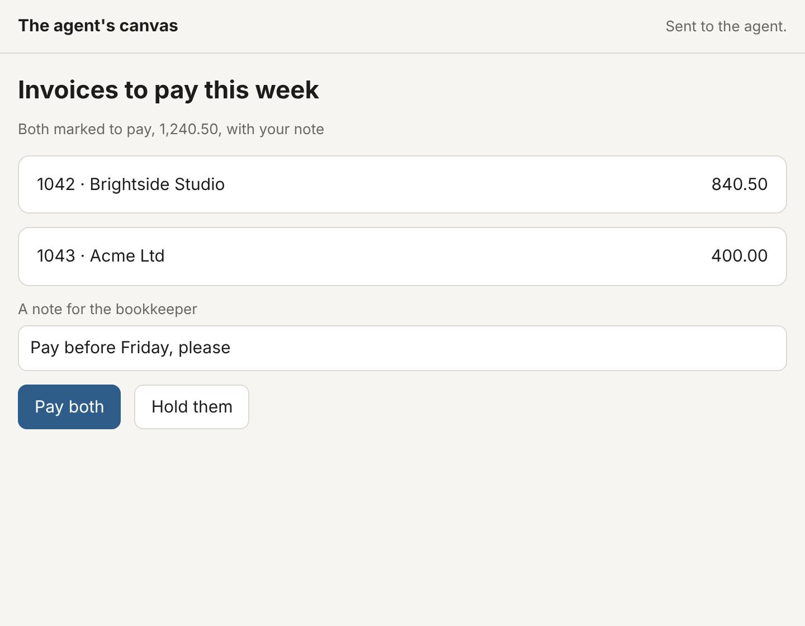

# A canvas

`--canvas` gives a session a page it shows a person things on while it
works: a summary, the rows it found, choices, a form. The person watches
the page change as the agent sends it, and what they press there comes
back to the agent. It is the agent's own screen for you, beside its
answers in words.

The output below is from a real run on a local devnet, the long
identifiers and the canvas's first message shortened with `…`. The model
is a **scripted** one, and the person a browser driven by a script
(Playwright's Chromium): the page, the server and the agent are as they
are with anyone.

## What it shows

What the agent shows is described, never programmed: messages of
[A2UI](https://a2ui.org) (the Agent-to-User Interface protocol, version
0.8), each naming components of a catalog by an id, as a list of who
holds whom:

- `surfaceUpdate` gives a surface's components;
- `dataModelUpdate` fills the surface's data model, which components'
  values may be bound to (`{"path": "/summary"}`), and a list may repeat a
  component for each of its entries;
- `beginRendering` shows the surface, from its root;
- `deleteSurface` takes one away.

The components are A2UI's standard ones: `Text` (headings, captions,
body), `Image`, `Row`, `Column`, `List`, `Card`, `Tabs`, `Divider`,
`Button`, `CheckBox`, `TextField`, `Slider` and `MultipleChoice`. A
canvas holds up to eight surfaces of 500 components each, 2 MiB in all.
Messages are checked before anything is shown, and applied all or none: an
unknown component, an id that is not one, an entry without a value, or a
picture from another site is refused, and the agent told why.

`canvas_show` sends messages; `canvas_wait` waits, up to ten minutes, for
what the person does: a button's action, with what they entered in the
fields its action names. An action is taken only as the button's own:
one the page did not show, or a name another than its button's, is
refused.

## A run

The agent shows the invoices still owed, a field for a note and two
buttons, and waits; the person writes a note and presses **Pay both**:

```text
$ sion agent run coder 9419c705…8440 --task 'Show me the invoices still owed, and pay what I choose.' --model script:canvas.json --canvas --autonomy L5 --no-reflect
the agent's canvas is at http://127.0.0.1:44097/0ba4b4f3…7c09c: open it on this machine to watch it
session e5c6ef4d2b868217 for agent 9419c705
  → canvas_show {"messages":[{"surfaceUpdate":{"components":[{"component":{"Column":{"children":{"explicitList":["title","summary","invoices","note","choices"]}}},"id":"root"},…]}},{"dataModelUpdate":…},{"beginRendering":{"root":"root","surfaceId":"main"}}]}
  ← the canvas holds main: 14 components, shown from root; no one is watching it at http://127.0.0.1:44097/0ba4b4f3…7c09c
  → canvas_wait {"seconds":120}
  ← the person pressed pay (pay on main), with {"note":"Pay before Friday, please"}
  → canvas_show {"messages":[{"dataModelUpdate":{"contents":[{"key":"summary","valueString":"Both marked to pay, 1,240.50, with your note"}],"surfaceId":"main"}}]}
  ← the canvas holds main: 14 components, shown from root; 1 person is watching it at http://127.0.0.1:44097/0ba4b4f3…7c09c
  → canvas_wait {"seconds":15}
  ← the person has done nothing on the canvas yet
agent: You chose to pay both invoices, 1,240.50 in all; the canvas shows them marked to pay, with your note.
session e5c6ef4d2b868217: done
```

The invoices are a list bound to the data model, each entry a card:

```json
{"id": "invoices", "component": {"List": {"children": {"template": {"dataBinding": "/owed", "componentId": "invoice"}}}}},
{"id": "invoice", "component": {"Card": {"child": "invoice-row"}}},
{"id": "invoice-row", "component": {"Row": {"distribution": "spaceBetween", "children": {"explicitList": ["who", "amount"]}}}},
{"id": "who", "component": {"Text": {"text": {"path": "who"}}}},
{"id": "pay", "component": {"Button": {"child": "pay-label", "primary": true,
  "action": {"name": "pay", "context": [{"key": "note", "value": {"path": "/note"}}]}}}}
```

The page as the person saw it, after the agent's answer:



## Where it is, and who sees it

The canvas is served from the start of the session, at an address of this
machine's that `sion` prints at once (what a run says comes when it ends,
and the person watches while it works). The address carries a token of
128 bits: a request without it, or for another host than the address
itself, is refused, and four people at most watch at once. The page runs
its own script only, renders what the agent sent with the browser's own
elements, its text as text, and reaches nothing but its own address: a
picture is shown only from bytes the agent gave (`data:` URLs), so that
what the canvas shows cannot carry anything to another site. Showing is a
write, not an external call: it stays on this machine.

Whoever holds the address acts as the person: what is pressed there
reaches the agent as the person's own (trust atom `agent:canvas`).

## What this does not do yet

- A canvas lives as long as the process that runs its session, at the
  same address from run to run: a session continued by another process
  gets a new canvas, empty, at a new address. Under `sion agent up`, it
  lives as long as the service.
- It is reached on this machine only, or through a tunnel of yours.
- A2UI's later versions, its components beyond the thirteen above
  (`Icon`, `Video`, `AudioPlayer`, `Modal`, `DateTimeInput`), and catalogs
  of one's own are not shown.
