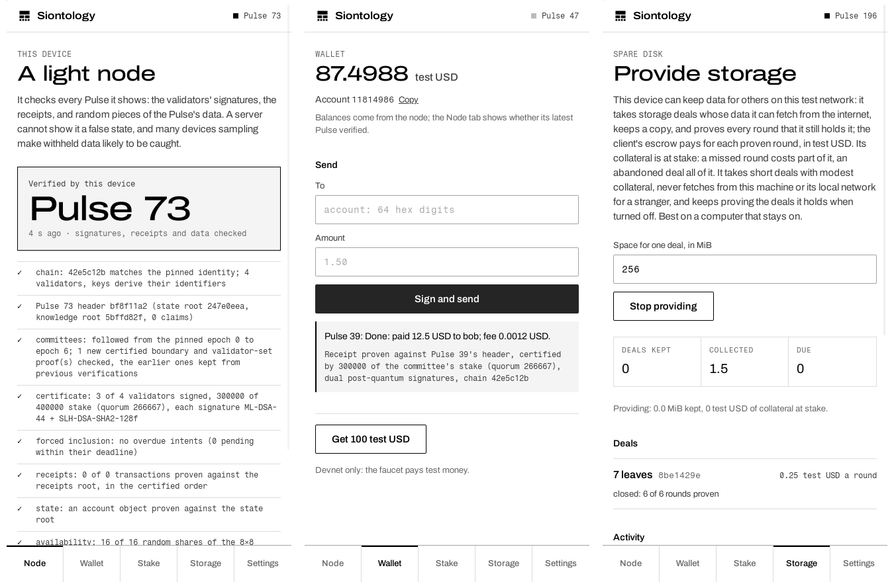

# The app

The Siontology app turns a laptop or a phone into a **light node**. It
holds the device's own key, and it checks every Pulse it shows instead of
trusting the server it talks to. Its owner can pay, delegate stake to a
validator without handing the stake over, and let the device keep data
for others ([storage deals](../concepts/storage.md)), on test networks
with test USD. Every amount it shows says so, in receipts and activity
too.

One Rust core, `sion-app-core`, does the work. A [Tauri 2](https://v2.tauri.app)
shell wraps it for desktop and mobile, under `apps/sion-app`.

| Layer | Where | What it does |
|---|---|---|
| Core | `crates/sion-app-core`, in the workspace | The key, the settings, light-client verification, payments, pooled stake and a storage provider, against any node's HTTP API. Tested against a devnet. |
| Shell | `apps/sion-app/src-tauri`, its own Cargo workspace | Tauri commands that forward to the core, and the platform's app-data directory. The GUI's dependencies stay out of the protocol's workspace. |
| Interface | `apps/sion-app/ui` | Static HTML, CSS and JavaScript. It holds no key and makes no network call: its content security policy allows only the shell's IPC. |



*The desktop build on Linux, against a four-validator devnet with
12-Pulse epochs.*

## What a device checks

Every eight seconds, and whenever you press **Verify now**, the core
verifies the latest certified Pulse the way `sion verify --no-world` does
([Verify as a light client](light-client.md)):

- **the chain identity**, against the one the app pinned the first time it
  verified a Pulse, or the one you pinned yourself;
- **the committee certificate**: validators holding more than two thirds
  of the epoch's stake signed the header, each with both post-quantum
  signatures, and the committee is followed from the pinned identity, not
  taken from the node;
- **the receipts**, against the header's receipts root;
- **the state**, an account proven against the state root, when the node
  is still at that Pulse;
- **availability**: 16 random shares of the Pulse's data square, at
  positions the node cannot predict, against the certified data root.

The device keeps the committees it has followed, so each verification
follows only the epoch boundaries since the last one, and it forgets the
committees of epochs it no longer needs.

The Node tab shows each check as one line, and a count of the
verifications that passed and failed. A node that serves a Pulse the
committee did not certify, or data that does not match it, fails
verification, and the tab says so in red.

Every transaction the device signs (a payment, a delegation, a claim)
comes back with its receipt **proven** against the certified header of the
Pulse it executed in, the way `sion receipt` proves one. The app waits for
the digest it computed itself, and what it shows, success or failure,
comes from the proven receipt only: a receipt it could not prove is shown
as the node's unproven claim, and one proven against a chain identity
that is not pinned yet is not marked as proven.

The app does not check the World Proof: re-executing a Pulse is a
desktop's or a server's job, not a phone's.

## What a device does not do

**It does not validate, store or serve the chain.** Validators run on
servers (`sion node`, see [Running a network of
processes](../guides/network.md)). Verifying pays nothing. On test
networks, with test USD, a device can keep data for others from the
Storage tab, paid by each deal's escrow for the rounds it proves, and its
owner can delegate stake from the Stake tab ([Pooled
stake](../concepts/validators/pooled-stake.md)).

**Its balances come from the node.** The Wallet tab shows what the node
reports for the device's account, unproven; the Node tab says whether the
node's latest Pulse checked out, and the device's own receipts are proven.
Proving every balance against the state root is the next step.

## Build and run it on a desktop

Linux needs WebKitGTK 4.1 and its companions; macOS and Windows need
nothing extra:

```bash
sudo apt-get install libwebkit2gtk-4.1-dev libgtk-3-dev librsvg2-dev libayatana-appindicator3-dev
cd apps/sion-app/src-tauri
cargo build --release
```

Start a devnet in another terminal and point the app at it:

```bash
sion devnet --port 8730
SION_NODE=http://127.0.0.1:8730 ./target/release/sion-app
```

`SION_NODE` sets the node on start; the Settings tab changes it later.
`SION_APP_DIR` overrides where the app keeps its state, which by default
is the platform's app-data directory, for example
`~/.local/share/org.siontology.app` on Linux.

Installers (`.deb`, `.AppImage`, `.dmg`, `.msi`) come from the Tauri CLI:

```bash
cargo install tauri-cli --version "^2" --locked
cargo tauri build
```

## The five tabs

- **Node**: the latest verified Pulse, the checks behind it, and the tally
  of verifications.
- **Wallet**: the device's account and balance, in test USD; *Send* signs
  a transfer to a 64-digit account with the device's key and shows its
  receipt. (Names are refused: on a devnet a name means a wallet whose
  keys anyone can derive from it.) On a devnet, *Get 100 test USD* asks
  the node's faucet.
- **Stake**: every validator with its own stake, the stake pooled behind
  it, its commission and its weight in the current epoch. *Delegate* puts
  stake in a validator's pool; each delegation shows its state and what it
  is owed, with *Collect*, *Leave* (undelegate) and *Withdraw*.
- **Storage**: *Provide storage* makes the device a storage provider. Every
  two seconds it proves the round under way for every deal it keeps,
  collects and closes, accepts the deals whose data arrived, and fetches
  new ones in the background: open deals on modest terms (see [Providers on
  people's devices](../concepts/storage.md#providers-on-peoples-devices))
  that fit the space it allows per deal, whose data comes from the
  internet. It never fetches from the device itself or its local network
  for a stranger (the `storage_local` setting allows it, for data on your
  own machines). Each proof expires at the end of its round, so a late one
  is refused for free instead of failing for a fee. *Stop providing* takes
  no new deals but keeps proving the ones it holds until they end, while
  the app runs: turning it off never abandons a deal. The tab shows the
  deals kept, what was collected and what is due.
- **Settings**: the node, and the pinned chain identity.

## Pinning the chain identity

The first Pulse that verifies pins the chain identity it was verified
against: trust on first use, like an SSH host key. The app says so when it
happens. From then on, a node of another chain, or one serving forged
validator keys, fails.

A first use against a lying node would pin the liar's chain. Compare the
pinned identity with one from a source you trust (a release, a friend, a
second node), or paste that one into *Pin an identity you trust* before
the first verification. If the settings ever cannot be read, the app keeps
the file aside as `settings.json.unreadable`, starts from the defaults,
says so, and does not pin on first use again until you pin an identity
(or unpin, which asks for the next verification to pin).

## Where its state lives

The app's directory holds two files:

- `key.seed`: the device's key, 32 bytes in hex, created on first start
  with mode 0600. It is not encrypted. A release for people's money would
  keep it in the platform's keystore (the Keychain, the Android Keystore),
  which this version does not do.
- `settings.json`: the node, the pinned chain identity, the number of
  shares sampled per Pulse and the storage settings, written whole and
  renamed into place so that a crash never leaves half a file.

Delete the directory to start over with a new key.

## Mobile

The same project builds for Android and iOS with the Tauri CLI, given the
Android SDK and NDK, or Xcode:

```bash
cargo tauri android init && cargo tauri android build
cargo tauri ios init && cargo tauri ios build
```

**Not built or tested yet**: the machine this was developed on has no
Android SDK or Xcode. The shell's entry point is already the mobile one,
and the interface is laid out for phones first.

## Using the core from another program

`sion-app-core` has no GUI dependency, so another shell (a command-line
watcher, a kiosk, a robot's controller) can use it directly. `AppCore` is
`Send + Sync`, every method takes `&self` and returns JSON, and a
verification in progress holds no lock, so a balance or a payment does not
wait for it. The device's own transactions are submitted one at a time,
so that two never spend the same coin.

```rust
use sion_app_core::AppCore;

let app = AppCore::open("/var/lib/my-light-node")?;
app.set_node("http://127.0.0.1:8730")?;
let verified = app.verify_latest()?;
println!("{}", verified["lines"]);
```
